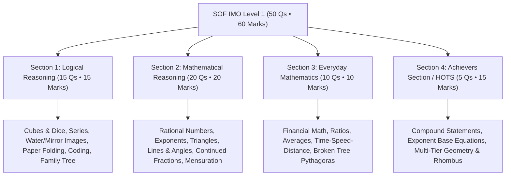

# SOF International Mathematics Olympiad (IMO) — Comprehensive Reference Handbook & Question Bank
*Official MTG IMO Olympiad Practice Series • Science Olympiad Foundation (SOF)*  
**Student**: Pushti Soni • **Curriculum**: Olympiad Foundation Track  
**Total Exam Papers Digitized**: 
- **2023-24 SET-B** (50 Questions • 60 Marks) — **100% Digitized ✅**
- **2022-23 SET-A** (50 Questions • 60 Marks) — **100% Digitized ✅**
- **2021-22 SET-A** (50 Questions • 60 Marks) — **100% Digitized ✅**
- **2021-22 SET-B** (50 Questions • 60 Marks) — **100% Digitized ✅**
- **Model Test Paper 1** (50 Questions • 60 Marks) — **100% Digitized ✅**
- **Model Test Paper 2** (50 Questions • 60 Marks) — **100% Digitized ✅**
- **2022-23 SET-B** (Q1–Q12 Captured • Intake in Progress)

---

## 📌 Executive Summary & Blueprint Architecture

The **Science Olympiad Foundation (SOF) International Mathematics Olympiad (IMO)** tests analytical reasoning, mathematical models, computational efficiency, and high-order problem solving (HOTS).

> [!IMPORTANT]
> **Standard Exam Blueprint (50 Questions • 60 Minutes • 60 Marks)**:
> 1. **Section 1: Logical Reasoning (Q1–Q15)**: 15 Questions × 1 Mark = **15 Marks**
> 2. **Section 2: Mathematical Reasoning (Q16–Q35)**: 20 Questions × 1 Mark = **20 Marks**
> 3. **Section 3: Everyday Mathematics (Q36–Q45)**: 10 Questions × 1 Mark = **10 Marks**
> 4. **Section 4: Achievers Section / HOTS (Q46–Q50)**: 5 Questions × 3 Marks = **15 Marks** (25% of total score from just 5 problems!)

---

## 🧭 Master Knowledge Base File Locations

All ingested data has been permanently compiled into dual-file pairs under `KB Files/mathematics/`:
* **2023-24 SET-B (50 Qs)**: [`math_imo_2023_24_set_b.json`](file:///d:/Users/expor/Downloads/Codes/KB%20Files/mathematics/olympiad_imo/imo_2023_24_set_b/math_imo_2023_24_set_b.json) • [`math_imo_2023_24_set_b.md`](file:///d:/Users/expor/Downloads/Codes/KB%20Files/mathematics/olympiad_imo/imo_2023_24_set_b/math_imo_2023_24_set_b.md)
* **2022-23 SET-A (50 Qs)**: [`math_imo_2022_23_set_a.json`](file:///d:/Users/expor/Downloads/Codes/KB%20Files/mathematics/olympiad_imo/imo_2022_23_set_a/math_imo_2022_23_set_a.json) • [`math_imo_2022_23_set_a.md`](file:///d:/Users/expor/Downloads/Codes/KB%20Files/mathematics/olympiad_imo/imo_2022_23_set_a/math_imo_2022_23_set_a.md)
* **2021-22 SET-A (50 Qs)**: [`math_imo_2021_22_set_a.json`](file:///d:/Users/expor/Downloads/Codes/KB%20Files/mathematics/olympiad_imo/imo_2021_22_set_a/math_imo_2021_22_set_a.json) • [`math_imo_2021_22_set_a.md`](file:///d:/Users/expor/Downloads/Codes/KB%20Files/mathematics/olympiad_imo/imo_2021_22_set_a/math_imo_2021_22_set_a.md)
* **2021-22 SET-B (50 Qs)**: [`math_imo_2021_22_set_b.json`](file:///d:/Users/expor/Downloads/Codes/KB%20Files/mathematics/olympiad_imo/imo_2021_22_set_b/math_imo_2021_22_set_b.json) • [`math_imo_2021_22_set_b.md`](file:///d:/Users/expor/Downloads/Codes/KB%20Files/mathematics/olympiad_imo/imo_2021_22_set_b/math_imo_2021_22_set_b.md)
* **Model Test Paper 1 (50 Qs)**: [`math_model_test_paper_1.json`](file:///d:/Users/expor/Downloads/Codes/KB%20Files/mathematics/model_test_papers/model_paper_1/math_model_test_paper_1.json) • [`math_model_test_paper_1.md`](file:///d:/Users/expor/Downloads/Codes/KB%20Files/mathematics/model_test_papers/model_paper_1/math_model_test_paper_1.md)
* **Model Test Paper 2 (50 Qs)**: [`math_model_test_paper_2.json`](file:///d:/Users/expor/Downloads/Codes/KB%20Files/mathematics/model_test_papers/model_paper_2/math_model_test_paper_2.json) • [`math_model_test_paper_2.md`](file:///d:/Users/expor/Downloads/Codes/KB%20Files/mathematics/model_test_papers/model_paper_2/math_model_test_paper_2.md)
* **2022-23 SET-B (Q1–12)**: [`math_imo_2022_23_set_b.json`](file:///d:/Users/expor/Downloads/Codes/KB%20Files/mathematics/olympiad_imo/imo_2022_23_set_b/math_imo_2022_23_set_b.json) • [`math_imo_2022_23_set_b.md`](file:///d:/Users/expor/Downloads/Codes/KB%20Files/mathematics/olympiad_imo/imo_2022_23_set_b/math_imo_2022_23_set_b.md)
* **Interactive Test Simulator**: 👉 [`imo_index.html`](file:///d:/Users/expor/Downloads/Codes/imo_index.html) (Full Practice & 60-Min Timed Exam Mode)

---

## 📐 High-Yield Mathematical & Reasoning Insights

### 1. Key HOTS Theorem & Formula Bank
* **Circle & Wire Bending**:
  $$\text{Length of Wire} = 2\pi r \implies r = \frac{L}{2\pi}, \quad \text{Area} = \pi r^2$$
* **Rhombus Inscribed in Rectangle**:
  $$\text{Shaded Area} = \text{Area of Rectangle} - 4 \times \left(\frac{1}{2} \times \frac{l}{2} \times \frac{b}{2}\right) = \frac{1}{2} \times l \times b$$
* **Broken Tree Pythagoras Word Problem**:
  $$\text{Original Height} = h_{\text{standing}} + \sqrt{h_{\text{standing}}^2 + d_{\text{base}}^2}$$
* **Continued Fraction Unwinding**:
  $$x + \frac{1}{2 + \frac{1}{2 + \frac{1}{2 - 1/2}}} = x + \frac{8}{19} = 2 \implies x = \frac{30}{19}$$
* **Exponential Base Balancing**:
  $$(16)^{2x + 3/2} = (8)^{2x/3 + 19/6} \implies 2^{4(2x + 3/2)} = 2^{3(2x/3 + 19/6)} \implies x = \frac{7}{12}$$

---

## 🎯 Master Answer Key Matrix (Six Complete Papers • 300 Questions)

### Previous Years Papers (2021–2024)

| Q# | 2023-24 Set-B | 2022-23 Set-A | 2021-22 Set-A | 2021-22 Set-B | Q# | 2023-24 Set-B | 2022-23 Set-A | 2021-22 Set-A | 2021-22 Set-B |
| :---: | :---: | :---: | :---: | :---: | :---: | :---: | :---: | :---: | :---: |
| **1** | B | B | B | C | **26** | A | D | C | A |
| **2** | C | C | C | D | **27** | C | A | A | B |
| **3** | C | D | D | B | **28** | A | D | A | D |
| **4** | A | C | A | B | **29** | B | C | C | C |
| **5** | D | D | D | B | **30** | C | B | D | C |
| **6** | B | A | B | A | **31** | A | B | B | C |
| **7** | B | C | C | B | **32** | D | D | B | A |
| **8** | B | C | D | B | **33** | C | B | B | D |
| **9** | C | B | C | A | **34** | D | D | C | B |
| **10** | C | A | C | A | **35** | A | C | A | B |
| **11** | D | C | C | C | **36** | C | D | C | B |
| **12** | B | B | C | C | **37** | C | C | C | C |
| **13** | B | B | D | B | **38** | C | A | A | D |
| **14** | D | C | C | D | **39** | D | A | D | A |
| **15** | A | C | B | D | **40** | C | B | B | B |
| **16** | B | A | C | B | **41** | C | A | D | C |
| **17** | A | A | B | B | **42** | C | B | A | C |
| **18** | A | D | A | D | **43** | A | C | D | B |
| **19** | A | A | D | B | **44** | B | A | A | B |
| **20** | A | B | C | A | **45** | A | B | B | C |
| **21** | C | C | B | D | **46** | A | D | B | D |
| **22** | C | D | C | B | **47** | B | C | C | C |
| **23** | B | C | C | A | **48** | D | C | C | B |
| **24** | C | B | C | D | **49** | C | B | B | B |
| **25** | C | A | D | B | **50** | B | D | D | C |

### Model Test Papers Suite

| Q# | Model Paper 1 | Model Paper 2 | Q# | Model Paper 1 | Model Paper 2 |
| :---: | :---: | :---: | :---: | :---: | :---: |
| **1** | A | C | **26** | A | B |
| **2** | C | A | **27** | D | D |
| **3** | A | A | **28** | B | B |
| **4** | B | A | **29** | C | D |
| **5** | C | A | **30** | A | B |
| **6** | D | C | **31** | D | D |
| **7** | A | B | **32** | B | C |
| **8** | C | D | **33** | C | B |
| **9** | B | C | **34** | A | D |
| **10** | D | D | **35** | D | B |
| **11** | A | B | **36** | B | B |
| **12** | C | C | **37** | A | C |
| **13** | B | D | **38** | C | B |
| **14** | D | B | **39** | B | C |
| **15** | C | D | **40** | D | B |
| **16** | A | A | **41** | A | C |
| **17** | C | B | **42** | C | D |
| **18** | B | D | **43** | B | D |
| **19** | D | B | **44** | D | B |
| **20** | B | B | **45** | C | B |
| **21** | A | A | **46** | D | C |
| **22** | C | A | **47** | B | A |
| **23** | B | B | **48** | B | B |
| **24** | D | D | **49** | A | A |
| **25** | C | A | **50** | B | A |
