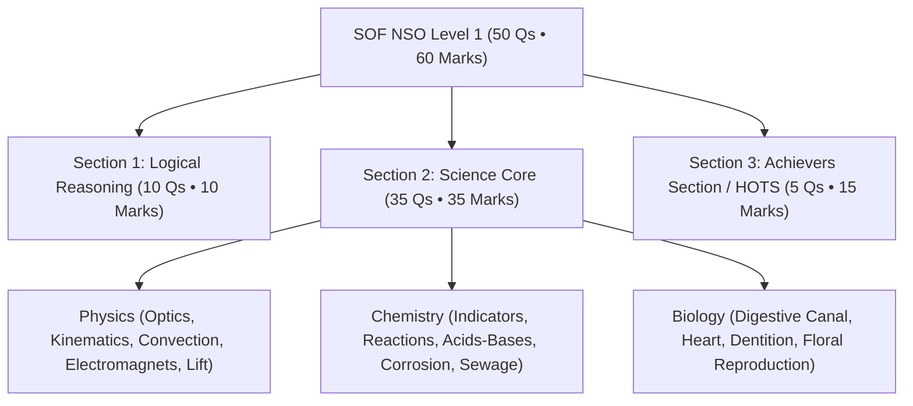

# SOF National Science Olympiad (NSO) — Comprehensive Reference Handbook & Question Bank
*Official MTG NSO Olympiad Practice Series • Science Olympiad Foundation (SOF)*  
**Student**: Pushti Soni • **Curriculum**: Olympiad Foundation Track  
**Total Exam Papers Digitized**:
- **2022-23 SET-A** (50 Questions • 60 Marks) — **100% Digitized ✅**
- **2022-23 SET-B** (50 Questions • 60 Marks) — **100% Digitized ✅**
- **2021-22 SET-A** (50 Questions • 60 Marks) — **100% Digitized ✅**
- **2021-22 SET-B** (50 Questions • 60 Marks) — **100% Digitized ✅**
- **Model Test Paper 1 (Science)** (50 Questions • 60 Marks) — **100% Digitized ✅**
- **Model Test Paper 2 (Science)** (50 Questions • 60 Marks) — **100% Digitized ✅**

---

## 📌 Executive Summary & Blueprint Architecture

The **Science Olympiad Foundation (SOF) National Science Olympiad (NSO)** assesses scientific acumen across Physics, Chemistry, and Biology, along with logical reasoning and experimental problem-solving.

> [!IMPORTANT]
> **Scoring & Section Distribution (50 Questions • 60 Minutes • 60 Marks)**:
> 1. **Section 1: Logical Reasoning (Q1–Q10)**: 10 Questions × 1 Mark = **10 Marks**
> 2. **Section 2: Science (Q11–Q45)**: 35 Questions × 1 Mark = **35 Marks**
>    - *Physics*: Motion, Optics, Thermal Convection, Circuits & Magnetic Induction, Bernoulli Aerofoil Lift, Cyclones
>    - *Chemistry*: Acids, Bases & Indicators, Displacement Reactions, Rusting Kinetics, Sewage Treatment, Water of Crystallisation
>    - *Biology*: Nutrition, Alimentary Canal Dimensions, Pulmonary Circulation, Dentition, Plant Floral Morphology, Penguin Countershading
> 3. **Section 3: Achievers Section / HOTS (Q46–Q50)**: 5 Questions × 3 Marks = **15 Marks** (25% of total score!)

---

## 🧭 Master Knowledge Base File Locations

All ingested data has been permanently compiled into dual-file pairs under `KB Files/science/`:
* **2022-23 SET-A (50 Qs)**: [`sci_nso_2022_23_set_a.json`](file:///d:/Users/expor/Downloads/Codes/KB%20Files/science/olympiad_nso/nso_2022_23_set_a/sci_nso_2022_23_set_a.json) • [`sci_nso_2022_23_set_a.md`](file:///d:/Users/expor/Downloads/Codes/KB%20Files/science/olympiad_nso/nso_2022_23_set_a/sci_nso_2022_23_set_a.md)
* **2022-23 SET-B (50 Qs)**: [`sci_nso_2022_23_set_b.json`](file:///d:/Users/expor/Downloads/Codes/KB%20Files/science/olympiad_nso/nso_2022_23_set_b/sci_nso_2022_23_set_b.json) • [`sci_nso_2022_23_set_b.md`](file:///d:/Users/expor/Downloads/Codes/KB%20Files/science/olympiad_nso/nso_2022_23_set_b/sci_nso_2022_23_set_b.md)
* **2021-22 SET-A (50 Qs)**: [`sci_nso_2021_22_set_a.json`](file:///d:/Users/expor/Downloads/Codes/KB%20Files/science/olympiad_nso/nso_2021_22_set_a/sci_nso_2021_22_set_a.json) • [`sci_nso_2021_22_set_a.md`](file:///d:/Users/expor/Downloads/Codes/KB%20Files/science/olympiad_nso/nso_2021_22_set_a/sci_nso_2021_22_set_a.md)
* **2021-22 SET-B (50 Qs)**: [`sci_nso_2021_22_set_b.json`](file:///d:/Users/expor/Downloads/Codes/KB%20Files/science/olympiad_nso/nso_2021_22_set_b/sci_nso_2021_22_set_b.json) • [`sci_nso_2021_22_set_b.md`](file:///d:/Users/expor/Downloads/Codes/KB%20Files/science/olympiad_nso/nso_2021_22_set_b/sci_nso_2021_22_set_b.md)
* **Model Test Paper 1 (50 Qs)**: [`sci_model_test_paper_1.json`](file:///d:/Users/expor/Downloads/Codes/KB%20Files/science/model_test_papers/model_paper_1/sci_model_test_paper_1.json) • [`sci_model_test_paper_1.md`](file:///d:/Users/expor/Downloads/Codes/KB%20Files/science/model_test_papers/model_paper_1/sci_model_test_paper_1.md)
* **Model Test Paper 2 (50 Qs)**: [`sci_model_test_paper_2.json`](file:///d:/Users/expor/Downloads/Codes/KB%20Files/science/model_test_papers/model_paper_2/sci_model_test_paper_2.json) • [`sci_model_test_paper_2.md`](file:///d:/Users/expor/Downloads/Codes/KB%20Files/science/model_test_papers/model_paper_2/sci_model_test_paper_2.md)
* **Interactive Test Simulator**: 👉 [`nso_index.html`](file:///d:/Users/expor/Downloads/Codes/nso_index.html) (Full Practice & 60-Min Timed Exam Mode)

---

## 🔬 Core Scientific Reactions & Formula Bank

### 1. Optical Mirror Rotation Theorem
$$\text{If mirror rotates by } \theta \implies \text{Reflected ray rotates by } 2\theta \text{ in same direction.}$$

### 2. Linear Thermometer Calibration Equation
$$\frac{L_T - L_0}{L_{100} - L_0} = \frac{T - 0}{100 - 0}$$

### 3. Key Chemical Reactions & Salt Hydrolysis
* **Neutralisation & $\text{CO}_2$ Evolution**:
  $$\text{CH}_3\text{COOH} + \text{NaHCO}_3 \to \text{CH}_3\text{COONa} + \text{H}_2\text{O} + \text{CO}_2\uparrow$$
* **Rust Formation on Steel**:
  $$4\text{Fe} + 3\text{O}_2 + 2x\text{H}_2\text{O} \to 2\text{Fe}_2\text{O}_3 \cdot x\text{H}_2\text{O} \quad (\text{Basic})$$
* **Acidic Salt Hydrolysis**:
  $$(\text{NH}_4)_2\text{SO}_4 \implies \text{Weak base } (\text{NH}_4\text{OH}) + \text{Strong acid } (\text{H}_2\text{SO}_4) \implies \text{pH} < 7$$

---

## 🎯 Master Answer Key Matrix (Six Complete Papers • 300 Questions)

### Previous Years Papers (2021–2023)

| Q# | 2022-23 Set-A | 2022-23 Set-B | 2021-22 Set-A | 2021-22 Set-B | Q# | 2022-23 Set-A | 2022-23 Set-B | 2021-22 Set-A | 2021-22 Set-B |
| :---: | :---: | :---: | :---: | :---: | :---: | :---: | :---: | :---: | :---: |
| **1** | B | D | D | B | **26** | A | A | A | D |
| **2** | C | C | A | D | **27** | D | C | B | D |
| **3** | B | C | C | A | **28** | B | D | D | C |
| **4** | D | C | B | C | **29** | B | C | C | D |
| **5** | B | B | C | C | **30** | B | D | C | C |
| **6** | B | C | C | D | **31** | D | B | A | B |
| **7** | C | B | B | B | **32** | A | C | D | D |
| **8** | B | C | D | D | **33** | C | A | C | C |
| **9** | A | B | A | C | **34** | A | A | A | B |
| **10** | C | D | C | D | **35** | A | A | A | C |
| **11** | A | C | B | B | **36** | D | D | B | A |
| **12** | B | B | B | D | **37** | B | A | A | A |
| **13** | D | B | D | D | **38** | A | D | B | C |
| **14** | C | B | A | C | **39** | D | D | B | B |
| **15** | B | B | A | A | **40** | A | A | A | D |
| **16** | B | A | D | D | **41** | D | B | D | D |
| **17** | D | A | B | C | **42** | C | D | D | A |
| **18** | D | C | A | D | **43** | D | D | A | D |
| **19** | A | B | D | C | **44** | B | B | C | A |
| **20** | C | C | B | B | **45** | D | C | A | C |
| **21** | A | B | C | C | **46** | B | A | B | D |
| **22** | B | C | C | B | **47** | B | D | D | B |
| **23** | C | C | A | C | **48** | A | D | A | C |
| **24** | B | B | C | C | **49** | B | D | D | D |
| **25** | B | C | C | A | **50** | A | C | C | B |

### Model Test Papers Suite

| Q# | Model Paper 1 | Model Paper 2 | Q# | Model Paper 1 | Model Paper 2 |
| :---: | :---: | :---: | :---: | :---: | :---: |
| **1** | D | B | **26** | C | A |
| **2** | B | A | **27** | D | C |
| **3** | C | C | **28** | A | C |
| **4** | D | C | **29** | C | D |
| **5** | D | D | **30** | B | A |
| **6** | D | A | **31** | B | D |
| **7** | B | A | **32** | D | C |
| **8** | B | B | **33** | C | D |
| **9** | A | D | **34** | A | B |
| **10** | A | A | **35** | C | D |
| **11** | C | C | **36** | C | A |
| **12** | D | A | **37** | B | D |
| **13** | A | B | **38** | D | A |
| **14** | B | C | **39** | C | B |
| **15** | C | D | **40** | C | D |
| **16** | B | B | **41** | C | B |
| **17** | C | C | **42** | B | D |
| **18** | A | D | **43** | A | A |
| **19** | B | A | **44** | C | A |
| **20** | C | D | **45** | A | C |
| **21** | D | D | **46** | A | D |
| **22** | B | B | **47** | C | B |
| **23** | B | C | **48** | D | B |
| **24** | B | A | **49** | D | B |
| **25** | D | C | **50** | B | D |
