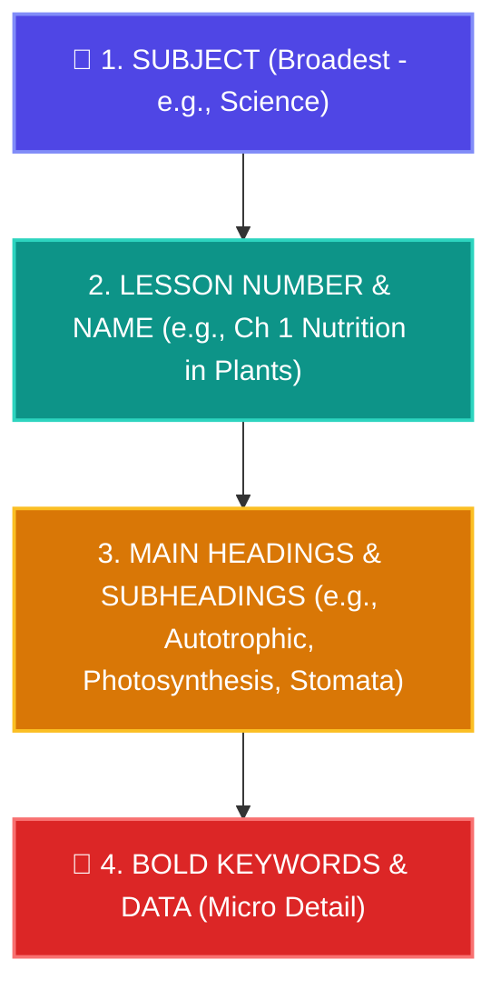

# 🌟 Pushti's Magic Memory Journey — Day 2 Master Workbook
**Student:** Pushti (Age 12, CBSE Class 7th)  
**Seminar:** Magic of Memory by Mr. Dharmesh Pithva (Savyasanchi – The Life School)  
**Date:** Day 2 (27 October 2026)  
**Target:** Mastering the A.I.R. System, Inverted Triangle of Registration, and CBSE Class 7 Pages 1–20 Mastery  

---

## 📞 Official Contacts & WhatsApp Helpline
* **Dharmesh Sir (Life Coach):** 93771 17712 / 94262 49626
* **Ashish Sir:** 98796 78911
* **Ankur Sir:** 90672 79494

---

## 🧠 Part 1: Core Techniques Decoded (Day 2 Syllabus)

### 1. The A.I.R. System (The Universal Memory Formula)
$$\text{Memory} = \text{Habit} \quad \text{powered by} \quad \mathbf{A} + \mathbf{I} + \mathbf{R}$$

| Letter | Principle | Gujarati Meaning | How Pushti Uses It |
|:---:|:---|:---|:---|
| **🅰️** | **Association** | **જોડવું (Connecting)** | Linking an unknown fact to a known anchor (e.g., Peg number, familiar object, or previous word). |
| **🇮** | **Imagination** | **કલ્પના કરવી (Mental Imaging)** | Seeing the picture in vivid 3D color, movement, and sound with eyes closed. |
| **🔁** | **Ridiculous** | **મજેદાર / હાસ્યાસ્પદ (Absurd)** | The brain deletes normal everyday events, but **locks in** funny, impossible, oversized cartoons! |

> [!NOTE]
> **Why Public Leaders (like Mr. Narendra Modi) Use A.I.R.:**
> In class, Dharmesh Sir highlighted how great speakers make speeches unforgettable by anchoring ideas to vivid emotional associations and relatable pictures rather than reciting plain text. When Pushti speaks or writes answers using A.I.R., her recall is effortless and captivating!

---

### 2. The Input vs. Output Law (The Brain's True Secret)
The human brain operates on three sequential stages:
$$\mathbf{Input} \longrightarrow \mathbf{Processing / Maintenance} \longrightarrow \mathbf{Output \ (Recalling)}$$

> [!IMPORTANT]
> **Golden Principle:** **"Output does NOT need correction. If the Input is perfected, Output is automatic and 100% accurate!"**
> - **Exam Blank-Out Myth:** Students often think *"I forgot the answer in the exam hall."* In reality, the memory wasn't lost; it was never encoded with a clear right-brain visual anchor during the **Input** stage!
> - When Pushti inputs data using A.I.R., the output is instant and stress-free.

---

### 3. Left Brain vs. Right Brain Activation
* **Left Brain (Logical / Text):** Processes words, logic, numbers, and plain black-and-white text. Retains only ~10% after 24 hours.
* **Right Brain (Visual / Emotion):** Processes images, colors, 3D space, emotions, and humor. Retains **90%+ long-term memory**!
* **The Magic:** By turning textbook definitions into cartoon stories, Pushti forces both hemispheres to work together (**Whole-Brain Super-Learning**).

---

### 4. The Sherlock Holmes Observation Principle
> *"We mostly see things rather than just observing."* — Sherlock Holmes

* **Seeing (Passive):** Glancing at a textbook page like wallpaper. No questions asked, no details registered.
* **Observing (Active):** Looking with active curiosity:
  - *What is at the top left?*
  - *Why is this diagram colored green?*
  - *What are the bold headings?*
* **Rule:** **Knowledge that can be questioned is easily remembered!**

---

### 5. Addressing & Registration (The Inverted Triangle)
To develop a **Photogenic (Photographic) Memory**, we move systematically from **Macro to Micro** using the Inverted Triangle:

#### Official 4-Step Page Registration Protocol:
1. **🔍 1. Observe the Page Carefully:** Look at the single page without rushing. Notice layout, colors, and diagrams.
2. **🧠 2. Visualize with Eyes Closed:** Close your eyes and "see" the page layout in your mind's eye.
3. **📖 3. One Page at a Time:** Never jump to page 2 until page 1's skeleton is clearly visualized!
4. **✅ 4. Focus on Main Points Only:** Anchor **Chapter Titles**, **Headings**, and **Bold Keywords** first. The paragraphs will naturally hang onto these anchor hooks!

---

## 📚 Part 2: CBSE Class 7 Science — Pages 1 to 20 Addressing Map

Using Pushti's actual textbook files in [`source_materials/science/`](file:///D:/Users/expor/Downloads/Codes/source_materials/science), here is the structured addressing map for Pages 1 to 20 (Chapters 1 & 2):

### 🌿 Chapter 1: Nutrition in Plants (Pages 1 – 11)

| Page Range | Section Level | Key Headings & Bold Anchors | A.I.R. Cartoon Mental Hook |
|:---:|:---|:---|:---|
| **Page 1–3** | **1.1 Modes of Nutrition** | • Autotrophs vs Heterotrophs • Nutrients: Carbohydrates, Proteins, Fats, Vitamins, Minerals | A giant green tree eating a lunchbox of vitamins and cooking food with solar sunglasses (**Autotroph** = Self-cook). |
| **Page 4–6** | **1.2 Photosynthesis** | • Chlorophyll (Green pigment) • Stomata (Tiny pores with guard cells) • Equation: $CO_2 + H_2O \xrightarrow{\text{Sunlight, Chlorophyll}} Carbohydrate + O_2$ | Leaves with tiny smiling mouths (**Stomata**) breathing in smoke ($CO_2$) and blowing out oxygen balloons for Pushti! |
| **Page 7–8** | **1.3 Other Modes of Nutrition** | • Parasitic (Cuscuta / Amarbel - yellow tubular) • Insectivorous (Pitcher plant trap) | A giant yellow rope (**Cuscuta**) tickling a host tree, while a **Pitcher plant** wears a cricket helmet catching flies like a wicketkeeper! |
| **Page 9–11** | **1.4 Saprotrophs & Symbiosis** | • Fungi (Mushrooms, bread mould) • Lichen (Alga + Fungus partnership) • Nutrient replenishment in soil (NPK) | A fungus and alga high-fiving: Alga cooks dinner, Fungus provides the house (**Symbiosis** best friends!). |

---

### 🦁 Chapter 2: Nutrition in Animals (Pages 12 – 20)

| Page Range | Section Level | Key Headings & Bold Anchors | A.I.R. Cartoon Mental Hook |
|:---:|:---|:---|:---|
| **Page 12–14** | **2.1 Feeding & Digestion** | • 5 Steps: Ingestion $\rightarrow$ Digestion $\rightarrow$ Absorption $\rightarrow$ Assimilation $\rightarrow$ Egestion • Amoeba: Pseudopodia (False feet) & Food Vacuole | An **Amoeba** growing long superhero rubber legs (**Pseudopodia**) and hugging a burger into its food tummy! |
| **Page 15–17** | **2.2 Human Digestive System (Mouth to Stomach)** | • Buccal cavity: 4 Tooth types (Incisors, Canines, Premolars, Molars) • Salivary amylase (Starch to Sugar) • Stomach: $HCl$ acid, Mucus, Pepsin | 32 cartoon teeth with scissor blades (Incisors) and dog fangs (Canines), diving down a water slide into a bubbling hot acid tub (**Stomach**)! |
| **Page 18–20** | **2.3 Small Intestine & Absorption** | • Liver (Bile juice stored in Gallbladder) • Pancreas (Pancreatic juice) • Villi (Finger-like projections with blood capillaries) | Millions of tiny yellow dancing fingers (**Villi**) catching floating nutrients and throwing them into rushing blood rollercoasters! |

---

## 🎯 Part 3: Homework Exercises & Practice Arena

### Exercise A: 10-Word Continuous Linking Stories (Official Class 7 Rule)
*Remember:* Write **ONLY the 10 words** in the notebook. Keep the hilarious cartoon movie strictly inside the mind!

#### Set 1: Everyday Wonder
$$\text{Helicopter} \longrightarrow \text{Ice Cream} \longrightarrow \text{Kangaroo} \longrightarrow \text{Toothpaste} \longrightarrow \text{Guitar} \longrightarrow \text{Umbrella} \longrightarrow \text{Dinosaur} \longrightarrow \text{Chocolate} \longrightarrow \text{Bicycle} \longrightarrow \text{Moon}$$
*Mental Movie Hook:* A helicopter with giant scoops of vanilla ice cream drops them on a kangaroo, who brushes its teeth with toothpaste while playing a rock guitar under a polka-dot umbrella with a baby dinosaur eating dairy milk on a flying bicycle all the way to the moon!

#### Set 2: Science & Magic Adventure
$$\text{Microscope} \longrightarrow \text{Pizza} \longrightarrow \text{Robot} \longrightarrow \text{Banana} \longrightarrow \text{Submarine} \longrightarrow \text{Football} \longrightarrow \text{Elephant} \longrightarrow \text{Sunglasses} \longrightarrow \text{Fireworks} \longrightarrow \text{Gold Trophy}$$

---

### Exercise B: Advanced Table Association (A.I.R. Dual Anchors)
For students who want to excel beyond the basic level (connecting a word to a Table Peg):

1. **Water + 41 (America):**  
   *Story:* Americans arrive at the airport and are welcomed with water balloons and pichkaris!
2. **Lion + 24 (Doctor - D):**  
   *Story:* A roaring lion sitting on an exam table wearing a stethoscope while the doctor checks its paws!
3. **Pencil + 03 (Chunky Panday):**  
   *Story:* Chunky Panday using a 10-foot tall pencil like a pogo stick to jump over cars!
4. **Laptop + 35 (Ernakulam):**  
   *Story:* A glowing laptop paddling a houseboat through the backwaters of Ernakulam!

---

## 📋 Homework Submission Form (Day 2 Ready)

For sheet `97727cb2-0326-4dc9-8f85-b2bff22ccb76.jpg`:

* **Student Name:** Pushti Soni  
* **ID / Batch:** Class 7th / Evening 6:30 PM – 9:30 PM  
* **Day:** 2 (27/10/2026)  

* **Today's Homework (આજનું હોમવર્ક):**  
  $\checkmark$ Completed 10-word continuous linking stories using A.I.R. (Association + Imagination + Ridiculous).  
  $\checkmark$ Practiced Table Peg dual associations (e.g. 41 America $\rightarrow$ Water).  
  $\checkmark$ Performed Addressing & Registration on **Pages 1 to 20** of Science (Ch 1 Nutrition in Plants & Ch 2 Nutrition in Animals).  
  $\checkmark$ Speed drill on Magical Table coordinates (00–99).

* **Difficulties in Homework (હોમવર્કમાં પડેલી મુશ્કેલીઓ):**  
  *"Moving from seeing a whole page to observing just the bold headings one page at a time felt slow at first, but closing my eyes to visualize the skeleton made the entire page layout snap into my right brain clearly!"*

* **What have you learnt today? (આજે તમે શું શીખ્યા?):**  
  *"I learned the A.I.R. system (Association + Imagination + Ridiculous) and the Inverted Triangle rule (Subject -> Lesson -> Headings -> Keywords). Most importantly, I understood that output recalling doesn't need fixing—if my input visual encoding is strong, recall happens automatically without exam stress!"*
