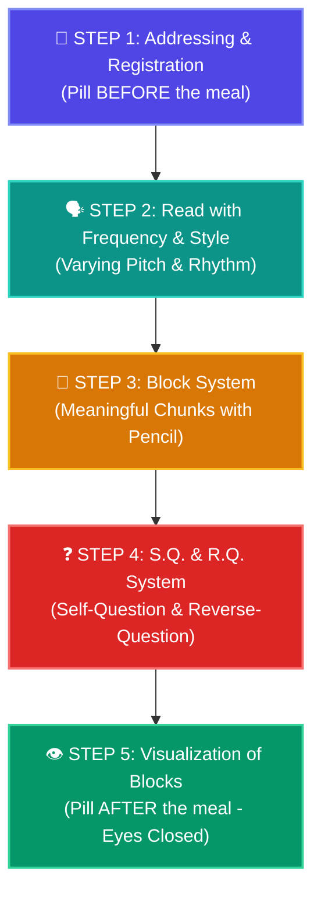

# 🌟 Pushti's Magic Memory Journey — Day 3 Master Workbook
**Student:** Pushti (Age 12, CBSE Class 7th)  
**Seminar:** Magic of Memory by Mr. Dharmesh Pithva (Savyasanchi – The Life School)  
**Date:** Day 3 (28 October 2026)  
**Target:** The 5-Step Dr. Bruno System, S.Q. & R.Q. Questioning, Frequency Reading & Pages 21–40 Science Mastery  

---

## 📞 Official Contacts & WhatsApp Helpline
* **Dharmesh Sir (Life Coach):** 93771 17712 / 94262 49626
* **Ashish Sir:** 98796 78911
* **Ankur Sir:** 90672 79494

---

## 🧠 Part 1: Core Techniques Decoded (Day 3 Syllabus)

### 1. The 5-Step Dr. Bruno System (ડૉ. બ્રુનો સિસ્ટમ)
Named after **Giordano Bruno** (1548–1600), the Renaissance philosopher and pioneer of the Art of Memory. This 5-step sequence is designed to memorize any textbook paragraph **line by line with zero rote cramming**:

| Step | Technique | Medical Metaphor | How Pushti Applies It |
|:---:|:---|:---|:---|
| **Step 1** | **Addressing & Registration** | **Pill Before the Meal** | Before reading details, register the Macro skeleton: Subject $\rightarrow$ Chapter Name $\rightarrow$ Main Headings. |
| **Step 2** | **Read with Frequency** | **Active Metabolism** | Read aloud with varying tone, drama, and rhythm as if teaching an audience. Never read in a boring monotone voice! |
| **Step 3** | **Block System (બ્લોક)** | **Chewing Data** | With pencil in hand, divide each sentence into meaningful thought units. *Rule: Never block the main keyword alone; block the meaningful phrase!* |
| **Step 4** | **S.Q. & R.Q. System** | **Digesting Data** | Turn each block into 2 questions: **S.Q. (Direct Question)** and **R.Q. (Reverse Question)**. |
| **Step 5** | **Visualization of Blocks** | **Pill After the Meal** | Close your eyes, review all blocks in order, and see the full mental movie. Allows **instant revision without opening the book**! |

> [!NOTE]
> **The Synchronization Rule:** Steps 2, 3, and 4 (Reading with frequency, marking blocks, and asking S.Q./R.Q.) happen **simultaneously** while studying the paragraph! Step 1 happens before, and Step 5 happens after.

---

### 2. The Frequency Secret: Why We Scored in Grades 1 to 4
* **The Puzzle:** Why do children easily memorize nursery rhymes and poems in early grades, but struggle with secondary science?
* **The Answer:** In primary school, content is delivered with **Music, Rhyme, Rhythm, and Varying Voice Frequency**!
* **The Brain Science:** Monotone flat reading makes brainwaves slow down into sleep/distraction mode. Modulating voice pitch and speaking expressively keeps the Reticular Activating System (RAS) firing at peak alertness!

---

### 3. The S.Q. & R.Q. Questioning Engine
The human brain is a **Question-Answering Engine**. A statement passes through passive short-term memory, but a question demands an active search:

$$\mathbf{S.Q. \ (Self \ Question)} \Longleftrightarrow \mathbf{R.Q. \ (Reverse \ Question)}$$

#### Example 1 (General Knowledge):
* Sentence: *"The capital of India is Delhi."* (Block = `CAPITAL`)
  - **S.Q. (Direct Question):** What is the capital of India? $\rightarrow$ **Delhi**.
  - **R.Q. (Reverse Question):** Delhi is the capital of which country? $\rightarrow$ **India**.

#### Example 2 (Class 7 Science — Photosynthesis):
* Sentence: *"Stomata are tiny pores on leaves enclosed by guard cells."* (Block = `STOMATA & GUARD CELLS`)
  - **S.Q. (Direct Question):** What are the tiny pores on plant leaves called? $\rightarrow$ **Stomata**.
  - **R.Q. (Reverse Question):** Stomata pores are protected and enclosed by which cells? $\rightarrow$ **Guard cells**.

---

### 4. The 4-in-1 Dual Flow (Input vs. Output Direction)
* **Input Direction (Registration):** **Macro $\longrightarrow$ Micro (Big to Small)**  
  Subject $\rightarrow$ Chapter $\rightarrow$ Topic $\rightarrow$ Headings $\rightarrow$ Block Words.
* **Output Direction (Exam Writing):** **Micro $\longrightarrow$ Macro (Small to Big)**  
  Trigger Keyword / Block $\rightarrow$ Expands into Sentence $\rightarrow$ Connects to Topic $\rightarrow$ Perfect Full Answer!

---

## 📚 Part 2: CBSE Class 7 Science — Pages 21 to 40 Addressing Map

Day 3 Homework assigns: **Visualize Main Points of Pages 21 to 40** (Continuing from yesterday's Pages 1 to 20).

### 🐄 Chapter 2 (Conclusion): Digestion in Grass-Eating Animals & Amoeba (Pages 21 – 24)

| Page Range | Section Level | Key Headings & Bold Anchors | Dr. Bruno S.Q. & R.Q. Hook |
|:---:|:---|:---|:---|
| **Page 21–22** | **2.3 Digestion in Ruminants** | • Rumen (First stomach chamber) • Cud (Partially digested food) • Rumination (Chewing the cud) • Cellulose digestion by bacteria in Caecum | **S.Q.:** Where do cows temporarily store swallowed grass? $\rightarrow$ **Rumen**. **R.Q.:** The rumen is the chamber where partially digested food forms what? $\rightarrow$ **Cud**. *Cartoon Hook:* Cow sitting with a chef hat, chewing bubblegum (cud) 50 times! |
| **Page 23–24** | **2.4 Feeding & Digestion in Amoeba** | • Microscopic single-celled organism • Pseudopodia (Capture prey) • Food vacuole (Digestive enzymes) • Expulsion of undigested waste | **S.Q.:** Which organelle in amoeba secretes digestive juices? $\rightarrow$ **Food Vacuole**. **R.Q.:** The food vacuole is formed when amoeba surrounds food using what? $\rightarrow$ **Pseudopodia** (False Feet). |

---

### 🔥 Chapter 3: Heat (Pages 25 – 40)

| Page Range | Section Level | Key Headings & Bold Anchors | Dr. Bruno S.Q. & R.Q. Hook |
|:---:|:---|:---|:---|
| **Page 25–28** | **3.1 Hot and Cold & Temperature** | • Reliable measure: Temperature (measured by Thermometer) • Clinical Thermometer: Range $35^\circ\text{C}$ to $42^\circ\text{C}$ (or $94^\circ\text{F}$ to $108^\circ\text{F}$) • Kink: Prevents mercury from falling back | **S.Q.:** What is the range of a human clinical thermometer? $\rightarrow$ **$35^\circ\text{C}$ to $42^\circ\text{C}$**. **R.Q.:** Which device has a special kink to prevent mercury from backflowing? $\rightarrow$ **Clinical Thermometer**. *Cartoon Hook:* Thermometer with a karate-chop bend (**kink**) guarding mercury like a security guard! |
| **Page 29–31** | **3.2 Laboratory Thermometer** | • Range: $-10^\circ\text{C}$ to $110^\circ\text{C}$ • Reading must be taken *while still immersed in the liquid* • Digital thermometers (No toxic mercury) | **S.Q.:** What is the range of a laboratory thermometer? $\rightarrow$ **$-10^\circ\text{C}$ to $110^\circ\text{C}$**. **R.Q.:** Why must a laboratory thermometer be read while inside the beaker? $\rightarrow$ Because it has **no kink**! |
| **Page 32–35** | **3.3 Transfer of Heat — Conduction** | • Conduction: Solid heat transfer from hotter end to colder end • Conductors: Metals (Iron, Copper, Aluminium) • Insulators / Poor Conductors: Wood, Plastic, Air, Water | **S.Q.:** The transfer of heat in solids between particles without their movement is what? $\rightarrow$ **Conduction**. **R.Q.:** Materials that do not allow heat to pass easily are called what? $\rightarrow$ **Insulators** (Wood/Plastic). *Cartoon Hook:* Metal spoon screaming as heat soldiers march across its handle! |
| **Page 36–38** | **3.4 Transfer of Heat — Convection** | • Transfer in liquids and gases by movement of particles • Warm fluid rises (lighter), cool fluid sinks (heavier) • **Sea Breeze (Day):** Cool breeze from sea to land • **Land Breeze (Night):** Cool breeze from land to sea | **S.Q.:** In coastal areas, during the day, where does the cool breeze blow from? $\rightarrow$ **From Sea to Land (Sea Breeze)**. **R.Q.:** The land breeze occurs at night because land cools down faster than what? $\rightarrow$ **The Sea**. *Cartoon Hook:* Hot air balloon rising above land during daytime, waving hello to cool waves! |
| **Page 39–40** | **3.5 Transfer of Heat — Radiation & Clothes** | • Radiation: Requires **NO medium** (Sunlight travels across vacuum of space) • Dark clothes absorb more heat (Winter) • Light clothes reflect heat (Summer) • Woollen clothes trap air (Air is poor conductor) | **S.Q.:** Which mode of heat transfer can travel through vacuum? $\rightarrow$ **Radiation**. **R.Q.:** Woollen clothes keep us warm in winter because wool traps what insulator? $\rightarrow$ **Air**. *Cartoon Hook:* Sun shooting golden heat laser beams across empty space hitting Pushti's umbrella! |

---

## 🎯 Part 3: Real Dr. Bruno Blocking Practice (Class 7 Science)

Here is how Pushti blocks a textbook paragraph line by line:

### Paragraph Example: Why Does the Wind Blow? (From Savyasanchi Image 2)
> *"The wind blows due to the heat of the sun which plays the most important role in influencing the wind and to change the weather. When the sun shines brightly, it heats up the land. Due to it, the air above the land gets heated up. The warm air over the land, being lighter, rises up. The cool air, which is heavier, moves in to replace the warm rising air. This movement of air causes blowing of wind."*

#### Step 3: Block Breakdown (With Pencil)
* `[Block 1: Heat of the Sun]` &rarr; Influences wind and weather.
* `[Block 2: Land Heats Up]` &rarr; Warms the air directly above it.
* `[Block 3: Warm Air Rises]` &rarr; Warm air is lighter, so it floats upwards.
* `[Block 4: Cool Air Rushes In]` &rarr; Heavier cool air moves in to take its place.
* `[Block 5: Air Circulation]` &rarr; This continuous movement creates the wind!

#### Step 4: S.Q. & R.Q. Generation
1. **Block 1:**
   - **S.Q.:** What provides the primary heat that drives wind and weather? $\rightarrow$ **The Sun**.
   - **R.Q.:** The heat of the sun causes what natural atmospheric phenomenon? $\rightarrow$ **Blowing of Wind**.
2. **Block 3 & 4:**
   - **S.Q.:** Why does warm air rise above the land? $\rightarrow$ Because it is **lighter**.
   - **R.Q.:** What happens to the cooler, heavier air when warm air rises? $\rightarrow$ It **moves in to replace it**.

#### Step 5: Post-Meal Visualization
Close your eyes: See the yellow sun heating red soil $\rightarrow$ hot red air rising like a balloon $\rightarrow$ cool blue air swooshing in from the side $\rightarrow$ feeling the cool gust of wind on your face!

---

## 📋 Homework Submission Form (Day 3 Ready)

For sheet `image10.png`:

* **Student Name:** Pushti Soni  
* **ID / Batch:** Class 7th / Evening 6:30 PM – 9:30 PM  
* **Day:** 3 (28/10/2026)  

* **Today's Homework (આજનું હોમવર્ક):**  
  $\checkmark$ Associated 20 words with Magical Table Pegs (00–99).  
  $\checkmark$ Visualized Main Points of **Pages 21 to 40** of Science (Ch 2 Ruminants & Ch 3 Heat).  
  $\checkmark$ Read 1 to 5 pages using the **5-Step Dr. Bruno System** (Addressing $\rightarrow$ Frequency Reading $\rightarrow$ Block System $\rightarrow$ SQ/RQ $\rightarrow$ Post-meal Visualization).  
  $\checkmark$ Practiced voice modulation and reverse questioning on textbook paragraphs.

* **Difficulties in Homework (હોમવર્કમાં પડેલી મુશ્કેલીઓ):**  
  *"At first, making reverse questions (R.Q.) from each block required conscious thought, but after 3 sentences, my brain started automatically turning every sentence into a two-way question road. Reading aloud with rhythm prevented any sleepiness!"*

* **What have you learnt today? (આજે તમે શું શીખ્યા?):**  
  *"I learned the 5-Step Dr. Bruno System and why monotone reading makes us forget. By breaking sentences into meaningful blocks and generating both S.Q. and R.Q., I can now close my eyes and revise complete textbook pages without having to open the book!"*
