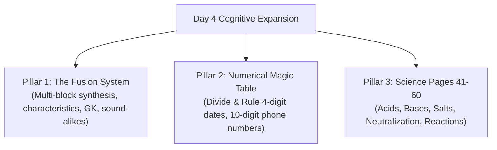
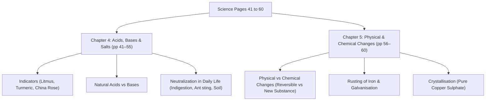

# 🌟 Pushti's Magic Memory Mastery — Day 4 Master Workbook
**Date:** 29 October 2026 (Day 4 of 7)  
**Student:** Pushti (12 Years Old, CBSE Class 7th, Silver Bells Public School, Bhavnagar)  
**Coach:** Mr. Dharmesh Pithva (Savyasanchi – The Life School)  
**Helplines:** D-Sir: 94262 49626 / 93771 17712 | A-Sir: 98796 78911 | Ankur Sir: 90672 79494  
**Target Milestone:** 🎯 **Grand Stage Demonstration — November 2, 2026**  
**Core Themes:** **The Fusion Memory System (ફ્યુઝન મેમરી સિસ્ટમ)** • **Numerical Data & Historical Dates via 100-Peg Magic Table** • **Phone Number Multi-Peg Movies** • **Science Pages 41–60 Addressing (Acids, Bases & Physical/Chemical Changes)**

---

## 📑 Table of Contents
1. [Day 4 Curriculum Architecture & Core Breakthroughs](#1-day-4-curriculum-architecture--core-breakthroughs)
2. [Pillar 1: The Fusion Memory System (ફ્યુઝન મેમરી સિસ્ટમ)](#2-pillar-1-the-fusion-memory-system-ફયઝન-મમર-સસટમ)
   - *What is Fusion?*
   - *When to Use & When NOT to Use (Sir's Rule of Restraint)*
   - *Sound-Alike Phonetic Breakdown (Antoine Lavoisier Example)*
   - *Symbolic Pictorial Notes vs Linear Line Format*
3. [Pillar 2: Numerical Data & Historical Dates via 100-Peg Magic Table](#3-pillar-2-numerical-data--historical-dates-via-100-peg-magic-table)
   - *The Divide and Rule Formula (4 Digits → 2 Pegs)*
   - *Classroom Master Examples (1498, 1857, 1192, 1761)*
   - *10-Digit Phone Numbers (Dharmesh Sir's 5-Peg Laboratory Movie)*
   - *Mandatory S.Q. & R.Q. on Numerical Associations*
4. [Pillar 3: CBSE Class 7 Science Pages 41 to 60 Addressing](#4-pillar-3-cbse-class-7-science-pages-41-to-60-addressing)
   - *Pages 41–48: Acids, Bases & Natural Indicators*
   - *Pages 49–55: Neutralization & Real-Life Applications*
   - *Pages 56–60: Physical vs Chemical Changes & Rusting Prevention*
5. [Official Homework Assignment & Action Checklist](#5-official-homework-assignment--action-checklist)
6. [Special Friday Schedule Alert (Tomorrow - Oct 30)](#6-special-friday-schedule-alert-tomorrow---oct-30)

---

## 1. Day 4 Curriculum Architecture & Core Breakthroughs

Day 4 marks the critical transition from **sequential narrative linking (Days 1–3)** to **dense conceptual synthesis and numerical indexing**. Dharmesh Sir introduced two major cognitive weapons:

---

## 2. Pillar 1: The Fusion Memory System (ફ્યુઝન મેમરી સિસ્ટમ)

### A. What is the Fusion System?
* The **Fusion System** is an advanced memory strategy that compresses multiple complex attributes, long theory answers, or abstract definitions into a **single, unified, symbolic mental picture or cartoon diagram** ($A + B \rightarrow \text{One Unified Picture}$).
* Rather than memorizing 6 separate lines of text in the analytical left brain, the mind synthesizes all features into a rich pictorial scene stored permanently in the visual right brain.
* When an exam question arrives, the student recalls **that single picture** and simply reads off the details like inspecting a colorful poster!

### B. When to Use the Fusion System (And When NOT to Use It!)
From Dharmesh Sir's verified WhatsApp instructions:

| Scenario | Use Fusion System? | Reason & Strategy |
|:---|:---:|:---|
| **High-Block Theory Answers** | ✅ **YES** | When a Bruno breakdown yields too many blocks (8+ blocks) and the theory feels slippery. |
| **Characteristics / Features** | ✅ **YES** | Multi-point properties (e.g., characteristics of acids, features of wind, traits of living organisms) easily blur together; Fusion anchors them as distinct physical traits on a cartoon character. |
| **General Knowledge & Multi-Facts** | ✅ **YES** | Connecting disparate facts (names, discoveries, locations, functions) into one cohesive scene. |
| **Similar / Confusing Types of Data** | ✅ **YES** | Eliminates interference between two closely related concepts (e.g., Clinical vs Laboratory Thermometers, Conduction vs Convection). |
| **Standard Short/Medium Answers** | ❌ **NO!** | **Sir's Rule of Restraint:** *If you can easily remember the answer using the Dr. Bruno 5-Step System alone, DO NOT use the Fusion System!* Do not overcomplicate straightforward material. |

### C. Sound-Alike Phonetic Breakdown (The "Anthony Levi on Lava" Technique)
Abstract scientific terminology and foreign names often slip out of memory because the brain cannot visualize meaningless sounds. The Fusion solution is **Phonetic Substitution**:

* **Target Name:** **Antoine Lavoisier** (Father of Modern Chemistry)
* **Breakdown into familiar sounds:**
  1. *Antoine* $\rightarrow$ **Anthony** (Actor/Friend)
  2. *Lavoisier* $\rightarrow$ **Levi's** (Jeans) + **Lava** (Volcano)
* **Unified Fusion Picture:**
  > Imagine **Anthony**, wearing stylish blue **Levi's jeans**, fearlessly climbing a smoking volcano while bright red, bubbling **lava** splashes around him, using test tubes to capture the fumes as chemistry sparks fly!
* **The Magic:** The moment someone asks *"Who is the father of chemistry?"*, the volcano movie plays in 0.2 seconds $\rightarrow$ *Anthony + Levi's + Lava* $\rightarrow$ **Antoine Lavoisier**!

### D. Symbolic Pictorial Notes vs Boring Linear Lines
* **The Traditional Trap:** Writing line 1, line 2, line 3, line 4 in black ink on white lined paper. This induces monotonous alpha-wave hypnosis; the left brain glazes over and retention drops below 20% after 48 hours.
* **The Fusion Method:**
  * Take a blank sheet (landscape orientation).
  * Draw a central humorous cartoon or symbolic icon (e.g., a giant laughing Cell phone for biological *Cell*).
  * Hang each key attribute on a specific part of the drawing (e.g., the screen = nucleus, battery = mitochondria, protective bumper case = cell wall).
  * A single glance refreshes 10 exam points instantly!

---

## 3. Pillar 2: Numerical Data & Historical Dates via 100-Peg Magic Table

Numbers have no inherent shape, color, or emotional resonance; therefore, raw dates (e.g., 1498, 1857, 1761) evaporate from memory. Day 4 solves this permanently using the **Divide and Rule Peg Formula**.

### A. The Divide and Rule Formula (4 Digits → 2 Pegs)
For any 4-digit historical year or numerical datum:
$$\text{Year } [ABCD] \longrightarrow [AB] \text{ (Peg 1)} + [CD] \text{ (Peg 2)}$$

1. **Step 1:** Split into two 2-digit numbers: $[AB]$ and $[CD]$.
2. **Step 2:** Look up $[AB]$ and $[CD]$ in Pushti's **100-Peg Magic Table (00–99)**.
3. **Step 3:** Form a ridiculous A.I.R. cartoon interaction connecting **Peg 1 + Peg 2 + The Historical Event**.
4. **Step 4:** Mandatory **S.Q. & R.Q.** to lock the two-way neural highway!

### B. Classroom Master Examples Decoded

#### Example 1: 1498 — Vasco da Gama arrives in India by Sea
* **Split:** `14` + `98`
* **Peg 14:** **Deepika Padukone** (or **Isha Deol** - Actress + D/E)
* **Peg 98:** **History** (Subject + H)
* **Event Anchor:** Vasco da Gama sailing his wooden ship into India.
* **A.I.R. Fusion Story:**
  > Imagine **Deepika** (or **Isha**) standing tall on the wooden deck of **Vasco da Gama's** caravels. As the ship enters Calicut, she is reading a 10-foot-thick **History** textbook out loud to the sailors while waves of spicy curry splash over the deck!
* **Two-Way S.Q. & R.Q. Highway:**
  * **S.Q. (Direct):** In which year did Vasco da Gama arrive in India? $\rightarrow$ *Deepika/Isha (14) + History (98) =* **1498**!
  * **R.Q. (Reverse):** What historical milestone occurred in 1498 (*Isha + History*)? $\rightarrow$ **Vasco da Gama discovered the sea route to India!**

#### Example 2: 1857 — First War of Indian Independence (Sepoy Mutiny)
* **Split:** `18` + `57`
* **Peg 18:** **Hema Malini** (Actress + H)
* **Peg 57:** **Glass** (Item + G)
* **Event Anchor:** The historic war for freedom against the East India Company.
* **A.I.R. Fusion Story:**
  > Imagine Bollywood dream girl **Hema Malini** charging onto the 1857 battlefield wearing warrior armor, holding a giant 20-foot crystal **Glass** of sparkling water. Whenever the enemy fires cannonballs, she catches them in the glass and neutralizes them with a splash!
* **Two-Way S.Q. & R.Q. Highway:**
  * **S.Q. (Direct):** What year was the First War of Indian Independence fought? $\rightarrow$ *Hema (18) + Glass (57) =* **1857**!
  * **R.Q. (Reverse):** What happened in 1857 (*Hema + Glass*)? $\rightarrow$ **The First War of Indian Independence!**

#### Example 3: 1192 — Second Battle of Tarain (Prithviraj Chauhan vs Muhammad Ghori)
* **Split:** `11` + `92`
* **Peg 11:** **Aishwarya Rai** (or **Alia Bhatt** - Actress + A)
* **Peg 92:** **Biology** (Subject + B)
* **Event Anchor:** Second Battle of Tarain.
* **A.I.R. Fusion Story:**
  > Imagine **Alia Bhatt** leading ancient medieval warriors into battle right inside a modern **Biology** lab, using microscope lenses to reflect sunlight at the enemy and riding a giant animated amoeba into the battle of Tarain!
* **Two-Way S.Q. & R.Q. Highway:**
  * **S.Q. (Direct):** When was the Second Battle of Tarain fought? $\rightarrow$ *Alia (11) + Biology (92) =* **1192**!
  * **R.Q. (Reverse):** What landmark battle took place in 1192 (*Alia + Biology*)? $\rightarrow$ **The Second Battle of Tarain!**

#### Example 4: 1761 — Third Battle of Panipat
* **Split:** `17` + `61`
* **Peg 17:** **Genelia D'Souza** (Actress + G)
* **Peg 61:** **Aunty** (Relation + A)
* **Event Anchor:** Third Battle of Panipat.
* **A.I.R. Fusion Story:**
  > Imagine actress **Genelia** getting into a dramatic, hilarious sword fight with her traditional **Aunty** on the plains of Panipat over the very last plate of crispy hot pani puris!
* **Two-Way S.Q. & R.Q. Highway:**
  * **S.Q. (Direct):** In which year was the Third Battle of Panipat fought? $\rightarrow$ *Genelia (17) + Aunty (61) =* **1761**!
  * **R.Q. (Reverse):** What historic clash occurred in 1761? $\rightarrow$ **The Third Battle of Panipat!**

---

### C. 10-Digit Phone Numbers (Multi-Peg Chain Movie)
Dharmesh Sir demonstrated how adults and memory champions remember 10-digit mobile numbers with 100% accuracy by chaining five 2-digit pegs:

* **Target:** **Mr. Dharmesh Pithva's Phone Number — `9377117712`**
* **Divide into 5 Pairs:**
  1. `93` $\rightarrow$ **Chemistry** (Subject + C)
  2. `77` $\rightarrow$ **Grapes / Gulab Jamun** (Food + G)
  3. `11` $\rightarrow$ **Alia Bhatt** (Actress + A)
  4. `77` $\rightarrow$ **Grapes / Gulab Jamun** (Food + G)
  5. `12` $\rightarrow$ **Bipasha Basu** (Actress + B)

* **The 5-Scene Master Laboratory Movie:**
  > **Dharmesh Sir** is in a science lab conducting a wild **Chemistry (93)** experiment. The bubbling test tubes suddenly erupt and shoot out warm, sweet **Gulab Jamuns (77)** into the air. **Alia Bhatt (11)** catches one in her mouth with joy, and immediately juggles another **Gulab Jamun (77)** across the room to **Bipasha Basu (12)**, who catches it while dancing on the lab bench!

Whenever anyone asks for Sir's number:
$$\text{Dharmesh Sir } \longrightarrow \text{Chemistry (93)} \rightarrow \text{Gulab Jamun (77)} \rightarrow \text{Alia (11)} \rightarrow \text{Gulab Jamun (77)} \rightarrow \text{Bipasha (12)} = \mathbf{9377117712}$$

---

## 4. Pillar 3: CBSE Class 7 Science Pages 41 to 60 Addressing

As assigned in the Day 4 official homework, Pushti must visualize and address **Pages 41 to 60** of CBSE Class 7 Science. Here is the structured Inverted Triangle breakdown:

### A. Pages 41–48: Acids, Bases & Natural Indicators
* **Acids:** Sour in taste, turn **Blue Litmus $\rightarrow$ Red**.
  * *Acetic acid:* Vinegar
  * *Citric acid:* Oranges, lemons
  * *Lactic acid:* Curd
  * *Oxalic acid:* Spinach
  * *Ascorbic acid (Vitamin C):* Amla, citrus
  * *Tartaric acid:* Tamarind, grapes, unripe mangoes
* **Bases:** Bitter in taste, soapy to touch, turn **Red Litmus $\rightarrow$ Blue**.
  * *Calcium hydroxide:* Lime water
  * *Ammonium hydroxide:* Window cleaner
  * *Sodium hydroxide / Potassium hydroxide:* Soap
  * *Magnesium hydroxide:* Milk of magnesia
* **Indicators (Detectors):**
  * **Litmus:** Extracted from Lichens. Purple in neutral water; Red in Acid; Blue in Base.
  * **Turmeric:** Stays Yellow in Acid/Neutral; turns deep **Red** in Base (why curry stains turn red when washed with soapy base!).
  * **China Rose:** Turns Acid $\rightarrow$ **Dark Pink (Magenta)**; turns Base $\rightarrow$ **Green**.

### B. Pages 49–55: Neutralization & Everyday Life Applications
* **Neutralization Reaction:**
  $$\text{Acid} + \text{Base} \longrightarrow \text{Salt} + \text{Water} + \text{Heat}$$
  *Example:* $HCl + NaOH \rightarrow NaCl + H_2O + \text{Heat}$.
* **Real-Life Neutralization Applications:**
  1. **Indigestion:** Stomach produces excess $HCl$. Treatment: Mild base antacid tablet like **Milk of Magnesia** ($Mg(OH)_2$).
  2. **Ant Sting:** Injects acidic **Formic acid**. Treatment: Rub with moist **Baking Soda** (Sodium hydrogen carbonate) or **Calamine solution** (Zinc carbonate).
  3. **Soil Treatment:**
     * Too acidic $\rightarrow$ Treat with quicklime ($CaO$) or slaked lime ($Ca(OH)_2$).
     * Too basic $\rightarrow$ Treat with organic matter / manure (releases acids to balance).
  4. **Factory Waste:** Highly acidic; must be neutralized with basic substances before discharging into water bodies to protect fish.

### C. Pages 56–60: Physical vs Chemical Changes
* **Physical Change:** Shape, size, color, or state changes; **no new substance formed**; mostly reversible (e.g., melting ice, folding paper, boiling water).
* **Chemical Change:** **One or more new substances formed**; accompanied by heat, light, gas production, or color change; mostly irreversible.
  * *Burning of Magnesium ribbon:* $2Mg + O_2 \rightarrow 2MgO$ (white ash). Adding water forms $Mg(OH)_2$ (basic).
  * *Copper Sulphate + Iron Nail:* Blue copper sulphate turns light green iron sulphate, and reddish brown copper deposits on the iron nail ($CuSO_4 + Fe \rightarrow FeSO_4 + Cu$).
  * *Vinegar + Baking Soda:* Generates $CO_2$ gas. When bubbled through lime water, it forms insoluble calcium carbonate, turning the water milky!
* **Rusting of Iron:**
  $$4Fe + 3O_2 + 2xH_2O \longrightarrow 2Fe_2O_3 \cdot xH_2O \text{ (Rust)}$$
  * Conditions: Requires **Both Oxygen and Water/Moisture**.
  * Prevention: Coating with paint/grease; **Galvanisation** (depositing a layer of zinc on iron); Alloying into stainless steel (iron + carbon + chromium + nickel + manganese).
* **Crystallisation:** Physical change technique to obtain large, pure crystals of substances (e.g., Copper Sulphate crystals) from an impure saturated solution.

---

## 5. Official Homework Assignment & Action Checklist

From the official Savyasanchi homework slip (`image1.png`):

- [ ] **Task 1: Associate 20 Words with Table**  
  Select 20 diverse nouns from textbooks or surroundings and anchor them to 00–99 pegs using comical A.I.R. cartoon scenes.
- [ ] **Task 2: Visualize Main Points of Pages 41 to 60 (Science)**  
  Perform Inverted Triangle Addressing for Acids/Bases (pp 41–55) and Physical/Chemical Changes (pp 56–60).
- [ ] **Task 3: Read 6 to 15 Pages with Dr. Bruno System**  
  Execute Steps 1 to 5 (Addressing $\rightarrow$ Frequency reading $\rightarrow$ Relational Blocks $\rightarrow$ S.Q./R.Q. $\rightarrow$ Post-visualization).
- [ ] **Task 4: Remember 10 Events / Dates with Table**  
  Use the Divide and Rule formula to encode 10 historical years (e.g., 1498, 1857, 1192, 1761, 1526, 1757, 1947).
- [ ] **Task 5: Make 1 Colorful Fusion Chart**  
  Draw a rich, single-page cartoon diagram synthesizing a complex concept (e.g., Acids vs Bases with indicator reactions) in landscape mode.

---

## 6. Special Friday Schedule Alert (Tomorrow - Oct 30)

> [!WARNING]
> **CRITICAL SCHEDULE REVISIONS FOR FRIDAY, 30 OCTOBER 2026 (DAY 5):**
> 1. **Pushti's Student Training:** Rescheduled to **5:00 PM – 8:00 PM** (instead of standard 6:30 PM).
> 2. **Parenting Session (For Parents):** **9:00 PM – 11:00 PM** at **યશવંતરાય નાટ્યગૃહ (Yashvantrai Natyagruh)**.

---
*Created with love for Pushti's Super-Memory Journey • Savyasanchi Magic of Memory 2026*
