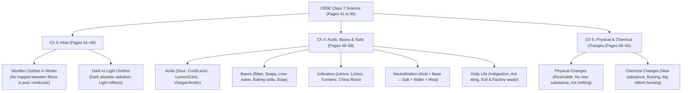

# 🌟 Pushti's Magic Memory Mastery — Day 4 Master Workbook
**Student:** Pushti (12 Years Old, CBSE Class 7th)  
**Trainer / Course:** Mr. Dharmesh Pithva (Savyasanchi – The Life School)  
**Session Date:** Thursday, 29 October 2026 (6:30 PM – 9:30 PM)  
**Milestone:** 🎯 **Grand Demo Day — Monday, November 2, 2026**  
**Workspace:** `D:\Users\expor\Downloads\Codes\source_materials\Pushti Magic Memory\Day 04 29102026`  

---

## 📑 Day 4 Executive Summary & Breakthroughs

Day 4 unlocked two monumental pillars of competitive memory:
1. **The Fusion Memory System (ફ્યુઝન મેમરી સિસ્ટમ 🔗🧠):**
   * How to condense massive multi-point theory answers, complex characteristics, and confusing similar concepts into **ONE single central visual diagram/cartoon** stored in the Right Brain.
   * **Phonetic Word Deconstruction:** How to convert impossible vocabulary or names into funny phonetic visual cartoons (e.g., *Antoine Lavoisier* $\rightarrow$ *On Lava + Anthony Levi* climbing an erupting volcano!).
   * **Dharmesh Sir's Golden Rule:** Always try the Bruno System first! Deploy the Fusion System only when an answer has too many blocks or dense theory that feels heavy.
2. **Numerical Data & Historical Dates (આંકડાકીય માહિતી 🔢⚔️):**
   * The **Divide & Conquer Technique:** Breaking 4-digit years into two 2-digit pairs (`YY` + `YY`).
   * Converting both pairs into permanent peg words using the **00–99 Magical Peg Matrix**.
   * Linking the two peg words with the historical event in a hilarious cartoon scene.
   * **Mandatory Two-Way Lock:** Always execute **S.Q. (Direct Question)** and **R.Q. (Reverse Question)** on the numerical story to ensure instant bidirectional exam recall!

---

## 🔗 Part 1: The Fusion Memory System (ફ્યુઝન મેમરી સિસ્ટમ)

### 1.1 What is the Fusion System?
Traditional note-taking is linear: line 1, line 2, line 3, bullet point 4... This only engages the Left Brain, inducing boredom and leading to blank-outs.  
The **Fusion System** fuses multiple facts, characteristics, and concepts into **a single symbolic cartoon or mind-map diagram**. Instead of memorizing 10 separate sentences, Pushti memorizes **one picture**, and then simply reads the details off the picture in her mind!

### 1.2 The 4 Ideal Use Cases (When to Use Fusion)
According to Dharmesh Sir's official WhatsApp directives:
1. **👩‍🎓 Long Theory Answers & Multi-Block Answers:** When an answer has so many Dr. Bruno blocks that sequential chaining feels cumbersome.
2. **✨ Characteristics & Features (લક્ષણો):** When memorizing 8–10 distinct properties of a topic (e.g., properties of acids, characteristics of living organisms, features of accounting concepts).
3. **📚 General Knowledge & Historical Facts:** When organizing diverse data points around a central entity.
4. **🔄 Similar / Confusing Information (એકસરખી માહિતી):** When two topics have overlapping features (e.g., Conduction vs Convection, Autotrophs vs Heterotrophs, Sea Breeze vs Land Breeze) and need clear visual distinction.

> [!IMPORTANT]
> **Dharmesh Sir's Warning on System Choice:**  
> You do **not** need to use the Fusion System for every question!  
> *If an answer can be easily remembered using Dr. Bruno's 5-Step Block System, stick with the Bruno System.* Reserve Fusion for multi-point characteristics, long theory, or complex diagrams.

### 1.3 Phonetic Word Deconstruction (A + B Picture Format)
When faced with difficult foreign names, scientific terms, or abstract jargon:
* Break the difficult word into funny, familiar-sounding phonetic fragments.
* Example taught in class:
  * **Antoine Lavoisier** (Father of Modern Chemistry):
    * Fragment 1: *On Lava* (Lava flowing from a volcano)
    * Fragment 2: *Anthony Levi* (A cartoon character wearing Levi's jeans)
    * Visual Scene: Anthony Levi is running up an erupting volcano, stepping directly *On Lava*, wearing glowing Levi's jeans while holding test tubes of chemical solutions!
  * **Cell (Biological Unit):**
    * Keyword trigger: *Cell Phone* ringing inside a plant leaf with a glowing cartoon nucleus answering the call!

---

## 🔢 Part 2: Numerical Data & Historical Dates (આંકડાકીય માહિતી)

### 2.1 The 4-Digit Split Formula
History is full of 4-digit years that look completely identical to the left brain.  
Dharmesh Sir taught the universal decoding formula:
$$\text{4-Digit Year } ABCD \longrightarrow \text{First Pair } AB + \text{Second Pair } CD$$
Each 2-digit number maps directly to the **00–99 Magical Peg Matrix** (Tens = Category, Units = Letter A to J).

### 2.2 Class Models Analyzed

| Year | Event | Pair 1 (Tens) | Pair 2 (Units) | Ridiculous A.I.R. Cartoon Scene |
|:---:|:---|:---:|:---:|:---|
| **1857** | **First War of Indian Independence** | **18:** Hema Malini *(Actress + H)* | **57:** Glass *(Item + G)* | Hema Malini charges onto the 1857 battlefield holding a 10-foot glowing glass of water to extinguish British cannons! |
| **1192** | **Second Battle of Tarain** | **11:** Alia / Aishwarya *(Actress + A)* | **92:** Biology *(Subject + B)* | Alia Bhatt rides into the medieval battlefield of Tarain using a gigantic Class 7 Biology textbook as a bulletproof shield! |
| **1761** | **Third Battle of Panipat** | **17:** Genelia *(Actress + G)* | **61:** Aunty *(Relation + A)* | Genelia gets into a wrestling match with her Aunty in 1761 at Panipat over the last 3 plates of spicy Pani Puri (3 = Third War)! |
| **1498** | **Vasco da Gama Arrives in India** | **14:** Deepika / Isha *(Actress + D)* | **98:** History *(Subject + H)* | Deepika Padukone sits on the sandy beach of Calicut holding a giant glowing History textbook to welcome Vasco da Gama's wooden sailing ship! |
| **1526** | **First Battle of Panipat (Mughal Empire)** | **15:** Esha Deol *(Actress + E)* | **26:** Fanaa *(Film + F)* | Esha Deol screens the movie *Fanaa* right on the battlefields of Panipat in 1526 to distract the enemy elephants! |
| **1556** | **Second Battle of Panipat (Akbar)** | **15:** Esha Deol *(Actress + E)* | **56:** File *(Item + F)* | 13-year-old Emperor Akbar signs royal treaties using an enormous metal nail file brought by Esha Deol! |
| **1947** | **Indian Independence** | **19:** Ishaa Koppikar *(Actress + I)* | **47:** Germany *(Country + G)* | Ishaa Koppikar flies a giant Indian tricolor flag from the top of the Brandenburg Gate in Germany to celebrate 1947 freedom! |

### 2.3 10-Digit Phone Number Pegging
* **Dharmesh Sir's 24x7 Helpline: `9377117712`**
  * `93` = Chemistry *(Subject + C)*
  * `77` = Gulab Jamun / Grapes *(Food + G)*
  * `11` = Alia *(Actress + A)*
  * `77` = Gulab Jamun *(Food + G)*
  * `12` = Bipasha *(Actress + B)*
  * *Story:* Dharmesh Sir is conducting a high-tech Chemistry experiment (93) where boiling test tubes shoot out sweet Gulab Jamuns (77), while Alia (11) catches them and serves another plate of Gulab Jamuns (77) to dancing Bipasha (12)!

### 2.4 The Mandatory S.Q. & R.Q. Validation Step
Never stop at just creating the story. Run the two-way question:
* **S.Q. (Direct Question):** When did Vasco da Gama arrive in India? $\rightarrow$ **1498**.
* **R.Q. (Reverse Question):** What historical milestone occurred in the year 1498? $\rightarrow$ **Vasco da Gama arrived in India by sea**.

---

## 🔬 Part 3: CBSE Class 7 Science Pages 41 to 60 Addressing Guide

As per Day 4 Homework Task #2, Pushti must visualize the main points of **Pages 41 to 60**. Here is the pre-mapped inverted triangle breakdown:

### 3.1 Chapter 3: Heat Wrap-Up (Pages 41–48)
* **Summer vs Winter Clothes:**
  * Light-coloured clothes reflect most heat radiation $\rightarrow$ keeps body cool.
  * Dark-coloured clothes absorb heat radiation $\rightarrow$ keeps body warm.
  * **Woollen Clothes in Winter:** Wool fibres trap air. Air is a poor conductor (insulator) of heat, preventing body heat from escaping into the cold surroundings!

### 3.2 Chapter 4: Acids, Bases and Salts (Pages 49–58)
* **Acids:** Sour taste. Derived from Latin word *acere* (sour).
  * Natural Organic Acids:
    * *Curd:* Lactic acid
    * *Citrus fruits (Oranges, Lemons):* Citric acid
    * *Vinegar:* Acetic acid
    * *Spinach:* Oxalic acid
    * *Amla / Citrus:* Ascorbic acid (Vitamin C)
    * *Tamarind, Grapes, Unripe mangoes:* Tartaric acid
* **Bases:** Bitter taste, slippery / soapy to the touch.
  * *Lime water:* Calcium hydroxide $[Ca(OH)_2]$
  * *Window cleaner:* Ammonium hydroxide $[NH_4OH]$
  * *Soap:* Sodium / Potassium hydroxide $[NaOH / KOH]$
  * *Milk of Magnesia:* Magnesium hydroxide $[Mg(OH)_2]$
* **Natural Indicators:**
  * **Litmus:** Extracted from Lichens. Mauve (purple) in distilled water; turns **RED in Acid**, **BLUE in Base**.
  * **Turmeric:** Yellow stain turns **RED in Basic solution** (e.g., soap applied to turmeric stain).
  * **China Rose (Gudhal):** Turns acidic solution **Dark Pink / Magenta**, turns basic solution **GREEN**.
* **Neutralisation Reaction:**
  $$\text{Acid} + \text{Base} \longrightarrow \text{Salt} + \text{Water} + \text{Heat}$$
  Example: $HCl + NaOH \rightarrow NaCl + H_2O + \text{Heat}$.
* **Neutralisation in Everyday Life:**
  1. *Indigestion:* Stomach produces excess $HCl$. Treated with antacid like Milk of Magnesia $[Mg(OH)_2]$.
  2. *Ant Sting:* Injects Formic acid into skin. Neutralised by rubbing moist baking soda (Sodium hydrogen carbonate) or calamine solution (Zinc carbonate).
  3. *Soil Treatment:* Acidic soil treated with quicklime $(CaO)$ or slaked lime $[Ca(OH)_2]$. Basic soil treated with organic compost.
  4. *Factory Waste:* Highly acidic waste neutralised with basic substances before discharging into rivers to protect aquatic life.

### 3.3 Chapter 5: Physical and Chemical Changes (Pages 58–60)
* **Physical Change:** Change in physical properties (shape, size, state). No new substance is formed. Usually reversible (e.g., melting of ice, stretching rubber band).
* **Chemical Change:** One or more **NEW substances** are formed. Accompanied by heat, light, sound, gas evolution, or color change. (e.g., Rusting of iron: $Fe + O_2 + H_2O \rightarrow Fe_2O_3$, burning of Magnesium ribbon: $2Mg + O_2 \rightarrow 2MgO$).

---

## 📸 Part 4: WhatsApp Class Images & OCR Analysis

| Image File | Description | Core Learning for Pushti |
|:---|:---|:---|
| [`image1.png`](file:///D:/Users/expor/Downloads/Codes/source_materials/Pushti%20Magic%20Memory/Day%2004%2029102026/image1.png) | **Day 4 Official Homework Sheet** | Contains Dharmesh Sir's 5 official student tasks for 29 Oct. |
| [`WhatsApp Image 2026-10-29 at 11.02.34 PM.jpeg`](file:///D:/Users/expor/Downloads/Codes/source_materials/Pushti%20Magic%20Memory/Day%2004%2029102026/WhatsApp%20Image%202026-10-29%20at%2011.02.34%20PM.jpeg) | **Fusion Chart: Financial Accounting Concepts** | Shows 12 accounting concepts (Going Concern, Money Measurement, Dual Aspect, Prudence) anchored onto one single visual map. |
| [`WhatsApp Image 2026-10-29 at 11.02.33 PM.jpeg`](file:///D:/Users/expor/Downloads/Codes/source_materials/Pushti%20Magic%20Memory/Day%2004%2029102026/WhatsApp%20Image%202026-10-29%20at%2011.02.33%20PM.jpeg) | **Fusion Diagram: Definition of Development** | Illustrates how abstract personality goals are mapped visually into connected cartoon nodes. |
| [`WhatsApp Image 2026-10-29 at 11.02.33 PM (1).jpeg`](file:///D:/Users/expor/Downloads/Codes/source_materials/Pushti%20Magic%20Memory/Day%2004%2029102026/WhatsApp%20Image%202026-10-29%20at%2011.02.33%20PM%20(1).jpeg) | **Fusion Diagram: Accounting Terms** | Connects transactions, assets, and liabilities using right-brain anchors. |
| [`WhatsApp Image 2026-10-29 at 11.02.35 PM.jpeg`](file:///D:/Users/expor/Downloads/Codes/source_materials/Pushti%20Magic%20Memory/Day%2004%2029102026/WhatsApp%20Image%202026-10-29%20at%2011.02.35%20PM.jpeg) | **Cell & Biological Fusion Sketch** | Demonstration of converting a biological cell into a single cartoon memory palace. |

---

## 📋 Part 5: Day 4 Official Homework Checklist

As per [`image1.png`](file:///D:/Users/expor/Downloads/Codes/source_materials/Pushti%20Magic%20Memory/Day%2004%2029102026/image1.png), here are Pushti's official tasks:

- [ ] **Task 1: Associate 20 Words with Table**  
  Select 20 new words and link them to pegs in the 00–99 table using humorous A.I.R. cartoon scenes.
- [ ] **Task 2: Visualize Main Points of Pages 41 to 60**  
  Review Science Pages 41–60 (Ch 3 Heat conclusions, Ch 4 Acids, Bases & Salts, Ch 5 Physical/Chemical changes) using the Inverted Triangle method.
- [ ] **Task 3: Read 6 to 15 Pages with Dr. Bruno System**  
  Execute the complete 5-step protocol (Addressing $\rightarrow$ Frequency reading $\rightarrow$ Relational Blocks $\rightarrow$ S.Q./R.Q. $\rightarrow$ Eyes-closed Visualization).
- [ ] **Task 4: Remember 10 Events with Peg Table**  
  Encode 10 historical events/dates using the 4-digit split method (`YY` + `YY`) and perform two-way S.Q./R.Q.
- [ ] **Task 5: Make 1 Colourful Fusion Chart**  
  Draw a hand-made colourful fusion chart for a multi-point school answer (e.g., Types of Acids, Neutralisation in Daily Life, or Characteristics of Living Organisms).
