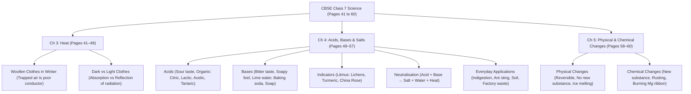

# 🧠 Pushti's Magic of Memory — Day 4 Comprehensive Companion Guide

**Student:** Pushti (Age 12, CBSE Class 7th)  
**Program:** Magic of Memory by Mr. Dharmesh Pithva (Savyasanchi – The Life School)  
**Session:** Day 4 (Thursday, 29 October 2026)  
**Target:** The Fusion Memory System, 4-Digit Historical Date Pegging, 10-Digit Number Encoding, and CBSE Class 7 Science Pages 41–60 Mastery  

---

# 🏫 PART 1: CLASSWORK (What Pushti Learned in Class)

This section documents the exact theories, slides, whiteboard diagrams, and homework rules introduced during Session 4.

---

## 1. The Fusion Memory System (ફ્યુઝન મેમરી સિસ્ટમ 🔗🧠)

### A. What is the Fusion System?
Linear text-based study (line 1, line 2, line 3, bullet point 4...) is a purely Left-Brain exercise that quickly triggers cognitive fatigue.  
The **Fusion System** fuses multiple disparate facts, features, and branch concepts into **one single central visual cartoon or radial mind map** stored permanently in the Right Brain. Instead of remembering 10 separate paragraphs, Pushti stores **one central visual picture**, and simply "reads" the facts off the cartoon elements in her mind's eye.

### B. The 4 Ideal Use Cases (When to Deploy Fusion)
Dharmesh Sir outlined four specific academic scenarios for Fusion:
1. **Long Multi-Point Answers:** Answers with too many sequential blocks where standard chaining becomes clumsy.
2. **Characteristics & Properties (લક્ષણો):** When memorizing 8–12 distinct features of a single entity (e.g., Properties of Acids, Characteristics of Living Organisms).
3. **General Knowledge Clusters:** When diverse geographic, scientific, or biographical facts revolve around one central subject.
4. **Similar / Confusing Concepts (એકસરખી / ગૂંચવણભરી માહિતી):** When two topics have overlapping features (e.g., Conduction vs. Convection, Physical vs. Chemical Changes) and need unmistakable visual separation.

> [!IMPORTANT]
> **Dharmesh Sir's Golden Rule on System Choice:**  
> Do **not** force every textbook question into a Fusion diagram!  
> *Always attempt Dr. Bruno's 5-Step Block System first.* Reserve Fusion for multi-point characteristics, dense theory, or complex relational diagrams.

---

## 2. Phonetic Word Deconstruction ($A + B$ Picture Format)

When encountering unfamiliar foreign names, complex biological terms, or abstract scientific jargon:
1. Break the difficult word into funny, familiar-sounding phonetic fragments.
2. Convert each fragment into an exaggerated visual cartoon.
3. Link the cartoon fragments dynamically to the concept definition.

### Class Slide Examples:
* **Antoine Lavoisier** (Father of Modern Chemistry):
  * *Fragment A:* **On Lava** (bubbling red lava erupting from a volcano)
  * *Fragment B:* **Anthony Levi** (a funny boy named Anthony wearing blue Levi's jeans)
  * *The Visual Fusion:* Anthony Levi is dancing barefoot **On Lava**, wearing glowing Levi's jeans while mixing bubbling chemical test tubes!
* **Biological Cell:**
  * *Trigger Anchor:* A giant **Cell Phone** ringing inside a green plant leaf; a cartoon nucleus picks up the receiver to answer!

---

## 3. Numerical Data & 4-Digit Historical Dates (આંકડાકીય માહિતી 🔢⚔️)

### A. The 4-Digit Split Formula
To the Left Brain, dates like $1857$, $1192$, and $1526$ look like interchangeable strings of numbers. The seminar introduced the universal encoding formula:

$$\text{4-Digit Year } ABCD \longrightarrow \text{First Pair } AB \ (\text{Tens}) + \text{Second Pair } CD \ (\text{Units})$$

Each pair translates into a concrete, permanent peg from the **00–99 Magical Peg Matrix** ($\text{Tens} = \text{Category}, \text{Units} = \text{Letter Initial } A\text{--}J$).

### B. Class Models Analyzed

| Year | Historical Milestone | Pair 1 ($AB$) | Pair 2 ($CD$) | Ridiculous A.I.R. Cartoon Scene |
|:---:|:---|:---:|:---:|:---|
| **1857** | **First War of Independence** | **18:** Hema Malini *(Actress H)* | **57:** Glass *(Item G)* | **Hema Malini** charges onto the battlefield carrying a 10-foot-tall glowing **Glass** of water to pour down British cannons! |
| **1192** | **Second Battle of Tarain** | **11:** Aliya *(Actress A)* | **92:** Biology *(Subject B)* | **Aliya Bhatt** rides into the Battle of Tarain using a thick Class 7 **Biology** textbook as a bulletproof shield! |
| **1761** | **Third Battle of Panipat** | **17:** Genelia *(Actress G)* | **61:** Aunty *(Relation A)* | **Genelia** gets into a funny fight with her **Aunty** over the last 3 plates of Panipat spicy *Pani Puri* (3 = 3rd Battle)! |
| **1498** | **Vasco da Gama Reaches India** | **14:** Deepika *(Actress D)* | **98:** History *(Subject H)* | **Deepika Padukone** stands on the beach of Calicut holding a giant **History** book, waving it like a flag to welcome Vasco da Gama! |
| **1526** | **First Battle of Panipat (Babur)** | **15:** Esha *(Actress E)* | **26:** Fanaa *(Film F)* | **Esha Deol** sets up a giant movie screen showing ***Fanaa*** right on the Panipat battlefield to distract the war elephants! |
| **1556** | **Second Battle of Panipat (Akbar)** | **15:** Esha *(Actress E)* | **56:** File *(Item F)* | 13-year-old Emperor Akbar charges into Panipat sharpening his royal sword with an oversized metal **File** brought by **Esha**! |
| **1947** | **Indian Independence** | **19:** Ileana *(Actress I)* | **47:** Germany *(Country G)* | **Ileana D'Cruz** climbs the Brandenburg Gate in **Germany** to wave the Indian Tricolour on Independence Day! |

### C. 10-Digit Mobile Number Encoding
* **Dharmesh Sir's Helpline:** `9377117712`
  * Break into pairs: `93` + `77` + `11` + `77` + `12`
  * `93` = Chemistry *(Subject C)*
  * `77` = Grapes / Gulab Jamun *(Food G)*
  * `11` = Aliya *(Actress A)*
  * `77` = Grapes / Gulab Jamun *(Food G)*
  * `12` = Bipasa *(Actress B)*
  * *The Story:* In a boiling **Chemistry** lab (`93`), test tubes shoot out sweet **Grapes** (`77`), which **Aliya** (`11`) catches and feeds to **Bipasa** (`12`) who is already eating another bowl of **Grapes** (`77`)!

### D. The Mandatory S.Q. & R.Q. Two-Way Lock
* **S.Q. (Direct Question):** When did Vasco da Gama arrive in India? $\rightarrow$ **1498**.
* **R.Q. (Reverse Question):** What major event happened in 1498? $\rightarrow$ **Vasco da Gama reached India by sea**.

---

## 4. Official Homework Assigned (Day 4 Sheet Verification)

From the official Day 4 workbook sheet (`image1.png`):

1. **Associate 20 Words with Table (૨૦ શબ્દોને ટેબલ સાથે એસોશિએટ કરવા):**
   * Link 20 new vocabulary terms directly to the 00–99 Magical Table pegs using A.I.R.
2. **Visualize Main Points of Pages 41 to 60 (૪૧ થી ૬૦ પેઈજના મેઈન પોઈન્ટસ વિઝ્યુલાઈઝ કરવા):**
   * Review Pages 41 to 60 in Science using the Inverted Triangle Addressing protocol.
3. **Read 6 to 15 Pages with Dr. Bruno System (૬ થી ૧૫ પેઈજ ડૉ. બ્રુનો સિસ્ટમથી વાંચવા):**
   * Practice the complete 5-step paragraph routine across 6–15 textbook pages.
4. **Remember 10 Events with Table (૧૦ ઐતિહાસિક ઘટનાઓ ટેબલથી યાદ કરવી):**
   * Encode 10 historical events/dates using the 4-digit split method and verify both S.Q. and R.Q.
5. **Make 1 Colourful Fusion Chart (૧ કલરફુલ ફ્યુઝન ચાર્ટ બનાવવો):**
   * Create a hand-drawn, multi-colored central visual diagram for a multi-point textbook topic.

---

# 🏡 PART 2: HOMEWORK & ADDITIONAL RESEARCH (Parent-Guided Deep Dive)

This section provides cognitive research explanations, a Class 7 Science addressing map for Pages 41–60, 10 pre-decoded CBSE Indian History dates, an exemplary Fusion Chart layout, and the filled Day 4 submission form.

---

## 1. Cognitive Mechanics of Fusion & Dual-Coding

### Why Fusion Beats Linear Outlines (Paivio's Dual-Coding Theory)
According to Allan Paivio's **Dual-Coding Theory**, the brain processes verbal information (words, numbers) and non-verbal information (images, spatial diagrams) through independent, parallel channels.
* Linear notes utilize only the verbal channel. When that single channel experiences interference, the entire memory chain breaks.
* A **Fusion Chart** triggers simultaneous dual-coding: the brain stores the spatial position, color, and cartoon character (visual code) alongside the technical definitions (verbal code).
* During exams, even if Pushti momentarily forgets a definition, her visual cortex recalls the *location and color* of the branch, instantly unlocking the associated text.

---

## 2. CBSE Class 7 Science: Pages 41 to 60 Structural Addressing Map

Here is the exact structural breakdown for Pages 41 to 60 of Pushti's **CBSE Class 7 Science Textbook** (covering Chapter 3 conclusion, Chapter 4, and Chapter 5 start):



### 🌿 Chapter 3: Heat Wrap-Up (Pages 41 to 48)

| Page Range | Macro Topic (Level 2/3) | Micro Keywords & Anchors (Level 4) | A.I.R. Ridiculous Mental Hook |
|:---:|:---|:---|:---|
| **Pages 41–44** | **Kinds of Clothes We Wear in Summer & Winter** | • Dark surfaces absorb more heat radiation<br>• Light-coloured surfaces reflect heat radiation<br>• Radiation requires no medium | A boy in summer wearing a mirror-suit reflecting sunbeams like disco lasers, while in winter he wears an all-black blanket absorbing heat like a sponge! |
| **Pages 45–48** | **Why Woollen Clothes Keep Us Warm** | • Wool is a poor conductor of heat<br>• Air is trapped in between wool fibres<br>• Trapped air prevents body heat from flowing to surroundings | A fluffy cartoon sheep stuffed with thousands of tiny balloons filled with **air** standing in the snow, sweating and drinking chilled lemonade! |

---

### 🧪 Chapter 4: Acids, Bases and Salts (Pages 49 to 57)

| Page Range | Macro Topic (Level 2/3) | Micro Keywords & Anchors (Level 4) | A.I.R. Ridiculous Mental Hook |
|:---:|:---|:---|:---|
| **Pages 49–51** | **Acids & Bases: Physical Properties & Sources** | • Acid = Sour (Latin: *acere*)<br>• Curd (Lactic), Citrus (Citric), Vinegar (Acetic), Ant sting (Formic)<br>• Base = Bitter, soapy to touch<br>• Lime water $[Ca(OH)_2]$, Milk of Magnesia $[Mg(OH)_2]$ | A lemon dressed as an angry green monster crying sour tears onto an ant (*Formic*), while a cake of soap slips out of a magician's hand foaming bitter bubbles! |
| **Pages 52–54** | **Natural Indicators Around Us** | • **Litmus:** Extracted from Lichens (Red in Acid, Blue in Base)<br>• **Turmeric:** Stays yellow in acid, turns **Red** in base (soap)<br>• **China Rose:** Turns acid **Dark Pink (Magenta)**, turns base **Green** | A yellow turmeric curry stain on a shirt screaming as a soap bar touches it, instantly blushing bright cherry **RED**! |
| **Pages 55–57** | **Neutralisation & Everyday Applications** | • $\text{Acid} + \text{Base} \rightarrow \text{Salt} + \text{Water} + \text{Heat}$<br>• *Indigestion:* Excess $HCl$ neutralised by antacid $[Mg(OH)_2]$<br>• *Ant Sting:* Formic acid neutralised by moist baking soda / calamine<br>• *Factory Waste:* Treated with bases before river disposal | A fiery dragon inside a belly spitting $HCl$ acid gets put to sleep when a glass of soothing chalky Milk of Magnesia douses the flames! |

---

### 💥 Chapter 5: Physical and Chemical Changes (Pages 58 to 60)

| Page Range | Macro Topic (Level 2/3) | Micro Keywords & Anchors (Level 4) | A.I.R. Ridiculous Mental Hook |
|:---:|:---|:---|:---|
| **Pages 58–60** | **Physical vs. Chemical Changes** | • **Physical Change:** Shape/size/state alters; **NO new substance formed**; mostly reversible (Melting ice, tearing paper)<br>• **Chemical Change:** One or more **NEW substances formed**; irreversible (Rusting iron, burning wood) | An ice cube melts into a puddle, then jumps back into the freezer to freeze again (Physical), while an iron nail turns into crumbly reddish-brown rust monster dust that can never turn back into steel (Chemical)! |

---

## 3. 10 Historical Events Encoded with the 4-Digit Split Method

Here are 10 key dates directly from the **CBSE Class 7 Social Science (History & Civics)** syllabus, decoded using the `YY + YY` Peg method:

| Event # | Historical Event | Year | Pair 1 ($AB$) | Pair 2 ($CD$) | Unforgettable Cartoon Story |
|:---:|:---|:---:|:---:|:---:|:---|
| **1** | **Second Battle of Tarain** (Prithviraj Chauhan vs Ghori) | **1192** | **11:** Aliya *(11)* | **92:** Biology *(92)* | **Aliya Bhatt** (`11`) charges into Tarain holding a giant Class 7 **Biology** textbook (`92`) to block flying arrows! |
| **2** | **Vasco da Gama arrives at Calicut** | **1498** | **14:** Deepika *(14)* | **98:** History *(98)* | **Deepika Padukone** (`14`) stands on Calicut beach reading an enormous **History** book (`98`) to direct Vasco da Gama's wooden ship ashore! |
| **3** | **First Battle of Panipat** (Babur establishes Mughal rule) | **1526** | **15:** Esha *(15)* | **26:** Fanaa *(26)* | **Esha Deol** (`15`) plays the movie ***Fanaa*** (`26`) on a screen between Babur's cannons and Ibrahim Lodi's elephants! |
| **4** | **Second Battle of Panipat** (Akbar defeats Hemu) | **1556** | **15:** Esha *(15)* | **56:** File *(56)* | Young Akbar signs his victory treaty using a massive steel nail **File** (`56`) presented by **Esha Deol** (`15`)! |
| **5** | **Third Battle of Panipat** (Marathas vs Ahmad Shah Abdali) | **1761** | **17:** Genelia *(17)* | **61:** Aunty *(61)* | **Genelia** (`17`) and her **Aunty** (`61`) wrestle in Panipat over the last 3 giant bowls of spicy *Pani Puri* (3 = 3rd Battle)! |
| **6** | **Battle of Plassey** (British rule begins in Bengal) | **1757** | **17:** Genelia *(17)* | **57:** Glass *(57)* | **Genelia** (`17`) smashes a massive drinking **Glass** (`57`) filled with mango juice over Robert Clive's tent at Plassey! |
| **7** | **Battle of Buxar** (British win tax collection rights) | **1764** | **17:** Genelia *(17)* | **64:** Daughter *(64)* | **Genelia** (`17`) and her **Daughter** (`64`) ride an elephant through Buxar collecting taxes inside golden piggy banks! |
| **8** | **First War of Indian Independence** | **1857** | **18:** Hema *(18)* | **57:** Glass *(57)* | **Hema Malini** (`18`) rides a galloping horse holding a giant magnifying **Glass** (`57`) that focuses sunlight to explode British gunpowder barrels! |
| **9** | **Abolition of Sati Act** (Raja Rammohan Roy) | **1829** | **18:** Hema *(18)* | **29:** Ishq *(29)* | **Hema Malini** (`18`) blasts the romantic song from the movie ***Ishq*** (`29`) through loudspeakers to stop a cruel Sati ritual! |
| **10** | **Indian Independence & Partition** | **1947** | **19:** Ileana *(19)* | **47:** Germany *(47)* | **Ileana D'Cruz** (`19`) flies from **Germany** (`47`) on an airplane to unfurl the Indian Tricolour on the Red Fort on 15 August 1947! |

---

## 4. Exemplary Fusion Chart Layout: "Acids, Bases & Neutralisation"

Pushti can draw this colorful radial diagram on an A4 blank sheet to fulfill **Task 5 (Make 1 Colourful Fusion Chart)**:

```
                          [ 🍋 CITRIC - Lemon / Orange ]
                                       ▲
  [ 🥛 LACTIC - Curd ] ◀─── 🔴 ACIDS (Sour / Red Litmus) ───▶ [ 🍇 TARTARIC - Tamarind ]
                                       │
                                       ▼ (pH Neutral Balance)
                         [ 💥 NEUTRALISATION IN DAILY LIFE ]
                         • Indigestion → Milk of Magnesia
                         • Ant Sting → Moist Baking Soda
                         • Acidic Soil → Quicklime / Slaked Lime
                         • Factory Waste → Basic Slurry
                                       ▲
                                       │
 [ 🪟 NH4OH - Window Cleaner ] ◀── 🔵 BASES (Bitter / Blue Litmus) ──▶ [ 🧼 NaOH - Soap Bar ]
                                       ▼
                       [ 🥛 Mg(OH)2 - Milk of Magnesia ]
```

* **Color Coding Advice for Pushti:**
  * Draw the **Acids branch in bright RED/ORANGE** (because acids turn litmus red).
  * Draw the **Bases branch in deep BLUE/PURPLE** (because bases turn litmus blue).
  * Draw the central **Neutralisation hub in GREEN** (signifying balance, health, and safe environmental discharge).

---

## 5. Completed Day 4 Submission Form

Use this exact text to fill in Pushti's printed Day 4 workbook sheet (`image1.png`):

* **Student Name:** Pushti Soni  
* **Batch / Time:** Class 7 / Evening Batch (6:30 PM – 9:30 PM)  
* **Day:** 4 (29 October 2026)  

### Today's Homework (આજનું હોમવર્ક)
* $\checkmark$ Associated 20 terms with the 00–99 Magical Peg Matrix using dynamic A.I.R. cartoon scenes.
* $\checkmark$ Visualized main points of **Pages 41 to 60 in Science** (Ch 3 Heat wrap-up, Ch 4 Acids, Bases & Salts, and Ch 5 Physical/Chemical changes) using the Inverted Triangle method.
* $\checkmark$ Read 6 to 15 textbook pages using Dr. Bruno's complete 5-Step Block & Frequency system.
* $\checkmark$ Memorized 10 historical events using the 4-digit split method (`YY + YY`) with two-way S.Q. & R.Q. confirmation.
* $\checkmark$ Prepared 1 hand-drawn, colorful Fusion Chart on "Acids, Bases & Neutralisation in Daily Life."

### Difficulties in Homework (હોમવર્કમાં પડેલી મુશ્કેલીઓ)
> *"Splitting 4-digit historical dates into two separate peg coordinates felt unfamiliar at first, but connecting the two peg characters in a funny action scene made the years lock into memory instantly. Drawing the Fusion Chart helped me see how an entire 8-page chapter fits onto a single sheet of paper!"*

### What have you learnt today? (આજે તમે શું શીખ્યા?)
> *"I learned the Fusion Memory System to combine multi-point theory answers into a single visual diagram. I also learned the 4-digit date splitting formula ($AB + CD$) to memorize history years without confusing them, and practiced phonetic deconstruction for hard vocabulary."*

---

## 6. Daily 10-Minute Parent-Child Home Drill (Day 4 Routine)

1. **4-Digit History Date Drill (4 Minutes):**
   * Call out an event: *"Pushti, when did Vasco da Gama arrive in India?"*  
     $\rightarrow$ She sees Deepika (`14`) reading History (`98`) $\rightarrow$ **1498**!
   * Reverse check (R.Q.): *"What happened in 1857?"*  
     $\rightarrow$ She sees Hema (`18`) with a giant Glass (`57`) blowing up cannons $\rightarrow$ **First War of Independence**!
   * *"When was the Second Battle of Tarain?"*  
     $\rightarrow$ Aliya (`11`) with Biology book (`92`) $\rightarrow$ **1192**!
2. **Fusion Map Walkthrough (3 Minutes):**
   * Place her colorful Fusion Chart in front of her.
   * Have her close her eyes and "walk" around the branches:
     * *"Point to the top branch—what acid is there?"* $\rightarrow$ Citric acid (lemon).
     * *"Point to the ant sting remedy—what base neutralises it?"* $\rightarrow$ Moist baking soda (Sodium hydrogen carbonate).
3. **Peg Speed Drill (3 Minutes):**
   * Rapid-fire test of the pegs used today:
     * *"What is 14?"* $\rightarrow$ **Deepika** (Actress D)
     * *"What is 98?"* $\rightarrow$ **History** (Subject H)
     * *"What is 26?"* $\rightarrow$ **Fanaa** (Film F)
     * *"What is 57?"* $\rightarrow$ **Glass** (Item G)
     * *"What is 64?"* $\rightarrow$ **Daughter** (Relation D)