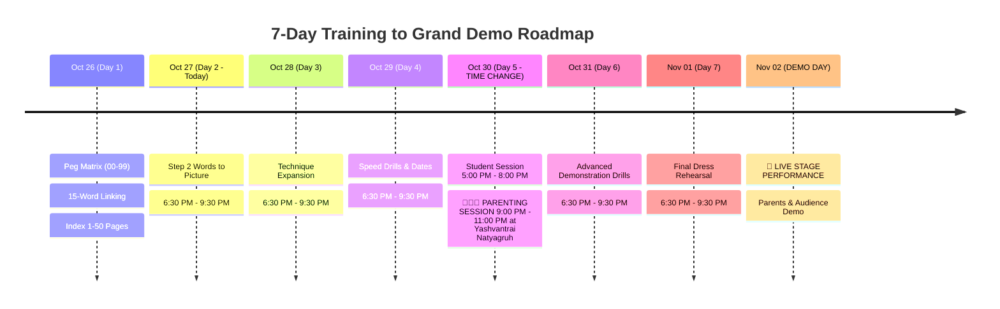

# 🚀 Pushti's Magic Memory Mastery — Central Course Tracker & Roadmap
**Student:** Pushti (12 Years Old, CBSE Class 7th)  
**Trainer / Seminar:** Mr. Dharmesh Pithva (Savyasanchi – The Life School)  
**Standard Timing:** Daily 6:30 PM – 9:30 PM (3 Hours)  
**Key Milestone:** 🎯 **GRAND DEMO DAY — November 2, 2026**  
**School Syllabus:** CBSE Class 7 (MTG, Oxford & Allied Publications)  
**Workspace:** `D:\Users\expor\Downloads\Codes\source_materials`  
**Hub Integration:** Connected directly to [Pushti Study Hub](file:///D:/Users/expor/Downloads/Codes/index.html) (Tab: *Magic Memory*)  

---

## 📞 Official Seminar Contacts & Helplines
* **Mr. Dharmesh Pithva (Life Coach & Founder):** 93771 17712 / 94262 49626
* **Mr. Ashish Sir:** 98796 78911
* **Mr. Ankur Sir:** 90672 79494

---

## 🗓️ Master Seminar Schedule & Important Alerts

> [!WARNING]
> **SPECIAL SCHEDULE ALERT FOR FRIDAY, 30 OCTOBER 2026:**
> 1. **Pushti's Student Training:** Rescheduled to **5:00 PM – 8:00 PM** (instead of 6:30 PM).
> 2. **Parenting Training (For Parents):** **9:00 PM – 11:00 PM** at **યશવંતરાય નાટ્યગૃહ (Yashvantrai Natyagruh)**.

---

## 📋 Official WhatsApp Operational Rules (Verified from Savyasanchi Group)

1. **Rule for 15-Word Stories (વાર્તા બનાવવાની રીત):**
   * **Write ONLY the words in the notebook!** Do **not** write out the story on paper. The story must happen **strictly inside the mind like a movie**.
   * Language flexibility: Stories can be in **English, Hindi, or Gujarati** — whatever makes the mental cartoon most vivid and funny for Pushti!
   * Close your eyes: If you cannot "see" the story clearly with eyes closed, make the action bigger and more exaggerated.

2. **Rule for Magical Table Pegs (00–99):**
   * **Coordinate Formula:** Category (Row) + Alphabet Letter (Column).
   * **Flexible Anchor Allowed:** As confirmed by Dharmesh Sir, if Pushti has another vivid word starting with that letter for the category, she can use it (e.g., for **30 [City + J]**, the printed sheet says *Jamnagar*, but Sir also allows *Jaipur*).

3. **Rule for Index Memory (ઇન્ડેક્સ સિસ્ટમ):**
   * Scope: **Pages 1 to 50** for Class 8 and below (Pushti is Class 7).
   * Two pieces of data must be anchored for each lesson:
     1. **Lesson Number** $\rightarrow$ **Lesson Name**
     2. **Lesson Name** $\rightarrow$ **Starting Page Number**
   * Note from Sir: The formal technique for numbers with data will be introduced soon, but anchoring the sequence begins now!

---

## 📅 Daily Tracking Index

| Day | Date | Session Timing | Focus & Techniques | Status | Materials & Workbooks |
|:---:|:---:|:---:|:---|:---:|:---|
| **Day 1** | 26/10/2026 | 6:30 PM – 9:30 PM | • Peg System (00–99) • 15-Word Linking Method • Index System (Pages 1–50) | $\checkmark$ Complete | [`Day 01 26102026/Pushti_Day01_Master_Workbook.md`](file:///D:/Users/expor/Downloads/Codes/source_materials/Day%2001%2026102026/Pushti_Day01_Master_Workbook.md) |
| **Day 2** | **27/10/2026** | **6:30 PM – 9:30 PM** | • Step 2: "Words to Picture" Transition • High-speed Visualization Enhancement | ⏳ **Tonight** | *Awaiting post-session notes / images* |
| **Day 3** | 28/10/2026 | 6:30 PM – 9:30 PM | • Expansion to larger datasets & abstract terms | 📅 Upcoming | To be prepared |
| **Day 4** | 29/10/2026 | 6:30 PM – 9:30 PM | • Speed drills, numerical memory, dates | 📅 Upcoming | To be prepared |
| **Day 5** | **30/10/2026** | **5:00 PM – 8:00 PM** | • Multi-subject integration • **Parenting Session: 9–11 PM @ Yashvantrai Natyagruh** | 📅 Upcoming | Special Friday schedule |
| **Day 6** | 31/10/2026 | 6:30 PM – 9:30 PM | • Fluency, reverse indexing, stage tricks | 📅 Upcoming | To be prepared |
| **Day 7** | 01/11/2026 | 6:30 PM – 9:30 PM | • Grand Demo Dress Rehearsal | 📅 Upcoming | To be prepared |
| **DEMO** | **02/11/2026** | **Grand Demo** | 🌟 **Live Demonstration of Super-Memory Feats** | 🎯 **Target Milestone** | Stage Ready Mastery |
